<p align="right"><a href="README.md">🇬🇧 English</a></p>

<a id="top"></a>

<p align="center">
  
</p>

<h1 align="center">Tramevia Dock</h1>

<p align="center">
  <b>Un seul chat, toutes tes alertes et ton titre sur toutes tes chaînes, directement dans OBS.<br>Pour Twitch, Kick, YouTube et TikTok LIVE. Sur ton PC ou en ligne, gratuit, sans savoir coder.</b>
</p>

<p align="center">
  <a href="LICENSE"></a>
  
  <a href="CHANGELOG.md"></a>
  
  
  <a href="https://github.com/Tramevia/Tramevia-Dock/discussions"></a>
</p>

<p align="center">
  <a href="#choisir"><b>Installer</b></a> · <a href="#tuto-pc"><b>Tuto PC</b></a> · <a href="#tuto-railway"><b>Tuto Railway</b></a> · <a href="#alertes"><b>Alertes</b></a> · <a href="#fonctionnalites"><b>Fonctionnalités</b></a> · <a href="#faq"><b>FAQ</b></a> · <a href="#aide"><b>💬 Aide</b></a> · <a href="#soutenir"><b>💜 Soutenir (Soon)</b></a>
</p>

<p align="center">
  <a href="https://github.com/sponsors/Tramevia"></a><br>
  <sub><b>Gratuit, sans pub, sans abonnement.</b> Si Tramevia Dock t’aide pour tes lives, le soutenir le fait vivre 💜</sub>
</p>

<p align="center">
  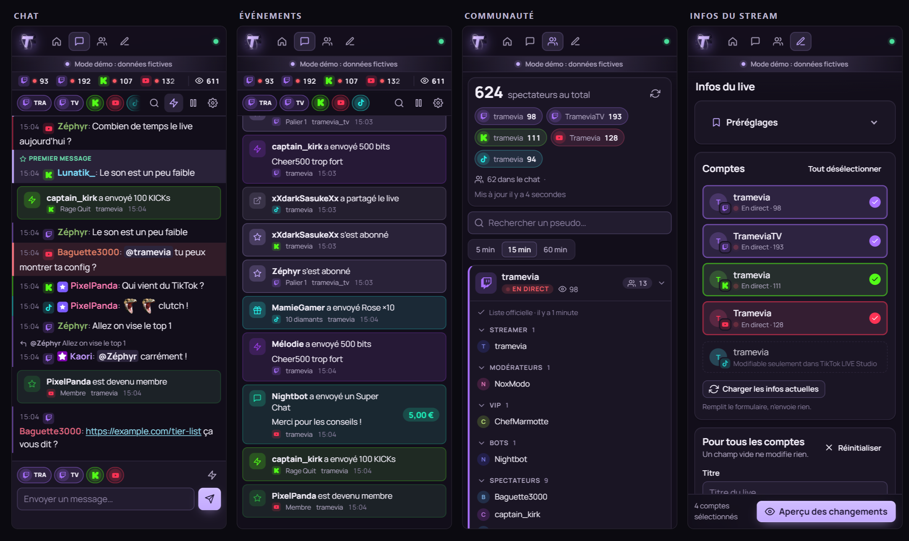
</p>

<p align="center"><sub>Les quatre docks, en mode démo. Un <b>dock</b>, c’est un petit panneau que tu ranges dans la fenêtre d’OBS, à côté de tes scènes : toi seul le vois.</sub></p>

### 👀 En action

<p align="center">
  <a href="https://youtu.be/-MKE4lyNyNw"></a><br>
  <sub>▶️ <b>Tramevia Dock en 30 secondes</b> (vidéo YouTube)</sub>
</p>

<table>
  <tr>
    <td width="50%" align="center">
      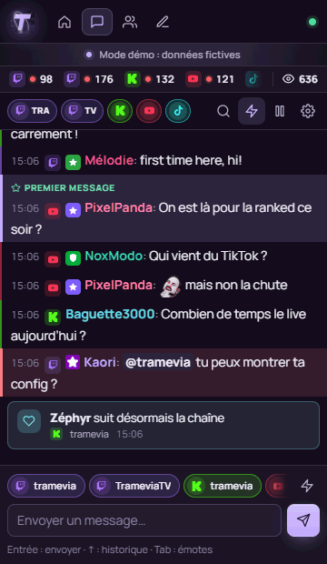
    </td>
    <td width="50%">
      <p><b>Tout ton chat dans un seul fil.</b><br>Les messages de toutes tes chaînes arrivent au même endroit, chacun avec l’icône de sa plateforme.</p>
      <p><b>Les émotes que ta commu connaît.</b><br>Émotes natives, 7TV, BTTV et FFZ, badges, et les mentions qui te concernent bien en vue.</p>
      <p><b>Les événements au milieu du chat.</b><br>Bits, abonnements, Super Chats, raids, cadeaux : tu ne rates personne.</p>
      <p><b>Tu écris une fois, tu choisis où.</b><br>Envoie ton message sur un seul compte ou sur plusieurs à la fois, réponds et modère sans changer d’onglet.</p>
    </td>
  </tr>
</table>

## 🆕 Nouveau dans la 1.4

- 🔔 **Des alertes à l’écran pour toutes tes plateformes.** Follows, subs, dons, raids, récompenses, cadeaux TikTok : une alerte à la fois, avec un son, dans **10 styles** animés. → [Voir les styles](#alertes)
- 👁️ **Un compteur de spectateurs en direct.** Le total de toutes tes chaînes dans un orbe de particules lumineuses, avec chaque hausse (+x) et chaque baisse (−x) animée. → [Étape 6](#etape-6)
- ☁️ **Installation en ligne en un clic.** Le bouton **Deploy on Railway** prépare tout ; tu ne choisis qu’un mot de passe. → [Tuto Railway](#tuto-railway)
- 💜 **Soutenir le projet (Soon).** Un bouton GitHub Sponsors et des codes soutien qui débloquent les nouveaux styles d’alertes en avance, à partir de la 1.4.5. → [Soutenir](#soutenir)

Le détail de chaque version : [CHANGELOG](CHANGELOG.md).

## 💜 Pourquoi Tramevia Dock ?

- 💬 **Un seul chat pour toutes tes plateformes.** Twitch, Kick, YouTube et TikTok (en lecture seule) dans le même dock. Tu lis, tu réponds et tu modères sans jongler entre les onglets.
- 🔔 **Tes alertes et ton compteur de spectateurs, sans service tiers.** Tout vient de tes propres connexions aux plateformes : pas de compte Streamlabs ou StreamElements à relier.
- 🏷️ **Titre, catégorie et tags partout en un clic.** Tu remplis une fois, tu vérifies l’aperçu, tu appliques. Tes réglages préférés deviennent des préréglages.
- 🏠 **Tes données restent chez toi.** Aucun compte Tramevia à créer, pas de serveur Tramevia au milieu, aucune donnée collectée, et tes accès sont chiffrés sur ton disque.
- 🎁 **Gratuit et libre.** Open source (AGPL-3.0), sans abonnement, en français et en anglais.

## 🧭 Comment ça marche

<p align="center">
  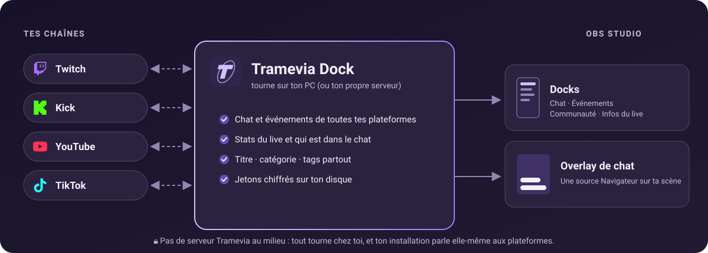
</p>

Tramevia Dock est un petit programme qui tourne **sur ton PC** ou **sur un serveur en ligne à toi** (par exemple Railway). Il se connecte directement à tes chaînes et rassemble tout au même endroit. OBS l’affiche ensuite de deux façons :

- des **docks** : des panneaux dans la fenêtre d’OBS (chat, événements, communauté, infos du live), visibles par toi seul ;
- des **overlays** : des calques transparents posés sur ta scène, que tes spectateurs voient sur le stream (ton chat, un message mis en avant, tes alertes, ton compteur de spectateurs).

Les deux sont de simples adresses web que tu colles une fois dans OBS.

<a id="choisir"></a>

## 🧩 Étape 0 : choisis où installer Tramevia Dock

Deux façons de faire, avec exactement les mêmes fonctionnalités. Pas sûr ? **Commence sur ton PC** : c’est gratuit, et tu pourras passer en ligne plus tard.

| | 💻 Sur ton PC | ☁️ En ligne avec Railway |
|---|---|---|
| **Prix** | Gratuit | Payant : offre Hobby de Railway, à partir d’environ 5 $ par mois ([tarifs actuels](https://railway.com/pricing)) |
| **Installation** | Node.js + un ZIP à extraire, puis un double-clic | Un bouton et un mot de passe, rien à installer |
| **Quand ça tourne** | Quand ton PC est allumé et que la fenêtre de Tramevia Dock est ouverte | 24 h/24, même PC éteint |
| **Ouvrir le tableau de bord** | Depuis ce PC uniquement, sans mot de passe | Depuis n’importe quel appareil, avec ton mot de passe |
| **Chat Kick** | Par le socket non officiel de kick.com (ça marche, mais non officiel) | Par les webhooks officiels de Kick |
| **Mises à jour** | Un clic sur « Installer maintenant » (ou automatiques si tu les actives) | Automatiques la nuit |
| **Temps** | Environ 10 minutes, plus 5 minutes par plateforme | Environ 5 minutes, plus 5 minutes par plateforme |
| **Tuto** | [Tuto PC](#tuto-pc) ↓ | [Tuto Railway](#tuto-railway) ↓ |

Ensuite, les deux chemins se rejoignent : tu connectes tes plateformes, tu ajoutes les docks et les overlays dans OBS ([étapes 2 à 7](#etape-2)).

> [!TIP]
> Tu veux d’abord faire le tour du propriétaire, sans rien connecter ? Le **mode démo** remplit tout avec de faux comptes, du faux chat et de fausses alertes, et rien n’est envoyé aux plateformes. Installe sur ton PC (étapes 1 à 3 du tuto PC), puis double-clique sur `demo.bat` au lieu de `start.bat` (macOS et Linux : `./start.sh --demo`). Toutes les captures de cette page viennent du mode démo.

<a id="tuto-pc"></a>

## 💻 Étape 1 (PC) : installer Tramevia Dock sur ton ordinateur

**Ce qu’il te faut :** Windows 10 ou 11, macOS ou Linux, [OBS Studio](https://obsproject.com) **31 ou plus récent**, et une connexion internet.

<a id="etape-1"></a>

### 🪟 Windows

1. **Installe Node.js.** C’est le moteur gratuit qui fait tourner Tramevia Dock. Va sur [nodejs.org](https://nodejs.org) et télécharge la version **LTS** (24.15 ou plus récente, fichier `.msi`). Lance l’installateur et clique sur « Next » jusqu’au bout, en gardant les options par défaut. Tu n’as à le faire qu’une fois.
2. **Télécharge Tramevia Dock.** Sur la [page de la dernière version](https://github.com/Tramevia/Tramevia-Dock/releases/latest), descends jusqu’à **Assets** et clique sur `tramevia-dock-X.Y.Z.zip` (X.Y.Z, c’est le numéro de version). Ne prends pas « Source code » : ce ZIP-là ne sait pas se mettre à jour tout seul.

   <p align="center">
     
   </p>

3. **Extrais le ZIP.** Clic droit sur le fichier téléchargé → « Extraire tout… », puis choisis un dossier qui ne bougera pas, par exemple `Documents\Tramevia Dock`. Ne lance rien directement depuis l’intérieur du ZIP.
4. **Double-clique sur `start.bat`** dans ce dossier. Si Windows affiche un avertissement de sécurité parce que le fichier vient d’internet, choisis de l’exécuter (sur l’écran bleu « Windows a protégé votre ordinateur » : « Informations complémentaires » → « Exécuter quand même »). `start.bat` est un simple fichier texte : tu peux l’ouvrir dans le Bloc-notes pour voir ce qu’il fait.
5. **Une fenêtre noire intitulée « Tramevia Dock » s’ouvre**, puis ton navigateur s’ouvre tout seul sur <http://localhost:8787>. C’est ton tableau de bord !

Si Node.js manque, la fenêtre noire te le dit et ouvre nodejs.org ; s’il est plus ancien que la version 24.15, elle te demande de le mettre à jour. Installe-le, puis double-clique de nouveau sur `start.bat`.

> [!IMPORTANT]
> **Laisse la fenêtre noire ouverte pendant que tu streames :** c’est elle qui fait tourner Tramevia Dock. Si tu la fermes, tes docks et tes overlays se vident. Pour l’arrêter, ferme-la (ou appuie sur Ctrl+C dedans). La prochaine fois, un double-clic sur `start.bat` suffit.

### 🍎 macOS

1. Installe **Node.js 24.15 ou plus récent** depuis [nodejs.org](https://nodejs.org) (l’installateur `.pkg` de la version LTS).
2. Télécharge `tramevia-dock-X.Y.Z.zip` dans **Assets** sur la [page de la dernière version](https://github.com/Tramevia/Tramevia-Dock/releases/latest), et décompresse-le dans un dossier qui ne bougera pas.
3. Double-clique sur **`start.command`**. Si macOS refuse de l’ouvrir parce qu’il vient d’un développeur non identifié, va dans **Réglages Système → Confidentialité et sécurité** et clique sur « Ouvrir quand même » (sur les versions plus anciennes : clic droit sur le fichier → « Ouvrir »).
4. Une fenêtre de Terminal s’ouvre, puis ton navigateur sur <http://localhost:8787>. Laisse le Terminal ouvert pendant tes lives.

### 🐧 Linux

Installe **Node.js 24.15 ou plus récent** (depuis [nodejs.org](https://nodejs.org) ou le gestionnaire de paquets de ta distribution, s’il est assez récent). Le plus simple : télécharge le ZIP depuis la [page de la dernière version](https://github.com/Tramevia/Tramevia-Dock/releases/latest), extrais-le, puis lance `./start.sh` dans ce dossier. Avec le ZIP, Tramevia Dock sait se mettre à jour en un clic. Tu préfères git :

```bash
git clone https://github.com/Tramevia/Tramevia-Dock.git
cd Tramevia-Dock
./start.sh
```

« Permission denied » ? Rends les scripts exécutables avec `chmod +x start.sh start.command`. Sous Wayland, OBS peut ne pas proposer les docks de navigateur : ouvre alors leurs adresses dans une fenêtre de navigateur classique.

<a id="premier-lancement"></a>

### ✅ Le premier lancement

<p align="center">
  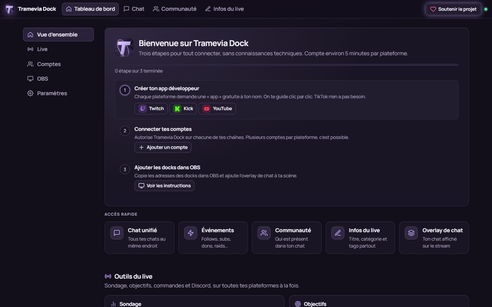
</p>

Le tableau de bord t’accueille avec trois étapes : créer ton app développeur, connecter tes comptes, ajouter les docks dans OBS. C’est exactement ce que font les [étapes 2 et 3](#etape-2) ci-dessous. En local, il n’y a **pas de mot de passe** : le tableau de bord ne répond qu’à ton propre ordinateur.

Tes comptes, tes réglages et tes clés vivent dans le dossier `data`, à côté de `start.bat` : **sauvegarde-le, et surtout `secret.key`**. Désinstallation, changement de port et réglages avancés : [guide d’installation](docs/fr/install.md).

> 💬 **Bloqué à cette étape ?** Regarde la [FAQ et dépannage](docs/fr/faq.md#dépannage), ou [pose ta question dans les Discussions](https://github.com/Tramevia/Tramevia-Dock/discussions/categories/q-a) : on t’aide.

Installation terminée : passe à l’[étape 2](#etape-2).

<a id="tuto-railway"></a>

## ☁️ Étape 1 (Railway) : installer Tramevia Dock en ligne

[Railway](https://railway.com) fait tourner Tramevia Dock pour toi sur un serveur, avec une adresse publique en HTTPS. Ton chat, tes alertes et tes docks marchent alors même PC éteint, depuis n’importe quel appareil, et le chat Kick passe par les webhooks officiels.

**Ce qu’il te faut :** un compte GitHub (ou une adresse e-mail) pour te connecter à Railway, et l’offre **Hobby** de Railway (payante, [tarifs actuels](https://railway.com/pricing)). L’essai gratuit limite les connexions sortantes, ce qui peut bloquer Twitch et Kick.

1. **Clique sur ce bouton :**

   [](https://railway.com/deploy/tramevia-dock?utm_medium=integration&utm_source=button&utm_campaign=tramevia-dock)

   La page du modèle Tramevia Dock s’ouvre sur Railway. Clique sur **Deploy Now** (1).

   <p align="center">
     
   </p>

2. **Connecte-toi à Railway.** Si tu n’as pas encore de compte, Railway te propose **Continue with GitHub** (1) ou une connexion par e-mail. Si Railway te le demande, passe à l’offre **Hobby** dans tes réglages de facturation.

   <p align="center">
     
   </p>

3. **Choisis ton mot de passe.** Railway affiche le service `tramevia-dock` avec **une seule variable à remplir : `ADMIN_PASSWORD`**. C’est le mot de passe de ton tableau de bord : **12 caractères minimum**, et pas celui de tes comptes de stream. Note-le dans ton gestionnaire de mots de passe. Clique ensuite sur **Deploy**.
4. **Attends la fin du déploiement** (une à deux minutes). Le modèle prépare tout seul l’image, le volume `/data` pour tes données, l’adresse publique, le contrôle de santé et les mises à jour automatiques de nuit. Le service passe au vert quand il est prêt.
5. **Ouvre ton adresse.** Clique sur le service `tramevia-dock` : son adresse publique, du type `https://tramevia-dock-production-xxxx.up.railway.app`, s’affiche sous son nom (et dans **Settings → Networking**). Ouvre-la : Tramevia Dock te demande ton mot de passe.

   <p align="center">
     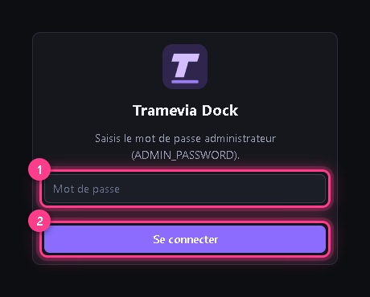
   </p>

6. **Connecte-toi** avec ton `ADMIN_PASSWORD` (1, 2). Le tableau de bord s’ouvre avec ses trois étapes, comme sur la [capture du premier lancement](#premier-lancement). Ajoute l’adresse à tes favoris : c’est ton tableau de bord, sur n’importe quel appareil.

> [!NOTE]
> **Ce qui change en ligne, pour la suite.**
> - Les **adresses de redirection** que l’assistant te donne à l’étape 2 commencent par ton adresse Railway (et non `localhost`). C’est normal : copie-les telles quelles. Si elles affichent encore `localhost`, redéploie le service.
> - Pour **Kick**, active aussi **Enable Webhooks** dans ton app Kick, avec l’adresse `https://ton-adresse.up.railway.app/webhooks/kick` : c’est ce qui donne le chat officiel (voir [Plateformes → Kick](docs/fr/platforms.md#kick)).
> - Une installation en ligne est **indépendante** de ton installation sur PC : elle a ses propres comptes et réglages. Les adresses des docks et des overlays pointent maintenant vers Railway : recopie-les dans OBS.
> - **Mises à jour** : elles s’installent toutes seules la nuit (2 h – 6 h UTC). Pour changer le créneau : **Settings → Source → Auto Updates** dans Railway.

Ton propre domaine, l’installation à la main pas à pas, les sauvegardes : [guide de l’hébergement en ligne](docs/fr/cloud.md#railway).

> 💬 **Bloqué à cette étape ?** « Host not allowed », service en erreur, mot de passe refusé : regarde la [FAQ et dépannage](docs/fr/faq.md#erreur-host-not-allowed), ou [pose ta question dans les Discussions](https://github.com/Tramevia/Tramevia-Dock/discussions/categories/q-a).

<a id="etape-2"></a>

## 🔌 Étape 2 : connecte tes plateformes

Tramevia Dock n’a pas de serveur central. Pour parler à ta chaîne, il utilise une **app développeur** à ton nom : pas de panique, c’est simplement une autorisation gratuite que tu crées sur le site de la plateforme. Grâce à elle, Tramevia Dock ne connaît **jamais ton mot de passe** et ne demande jamais ta clé de stream.

1. Dans le tableau de bord, ouvre **Comptes** et clique sur « Configurer l’app Twitch ».
2. Suis les étapes numérotées. Des boutons ouvrent les bonnes pages, et les boutons « Copier » te donnent le nom de l’app et l’adresse de redirection à coller.
3. Colle ton **Client ID** et ton **Client Secret** dans « Colle tes identifiants ici », puis clique sur « Enregistrer et tester ».
4. Clique sur « Connecter mon compte Twitch » et accepte sur la page de Twitch. C’est connecté ! ✅

<p align="center">
  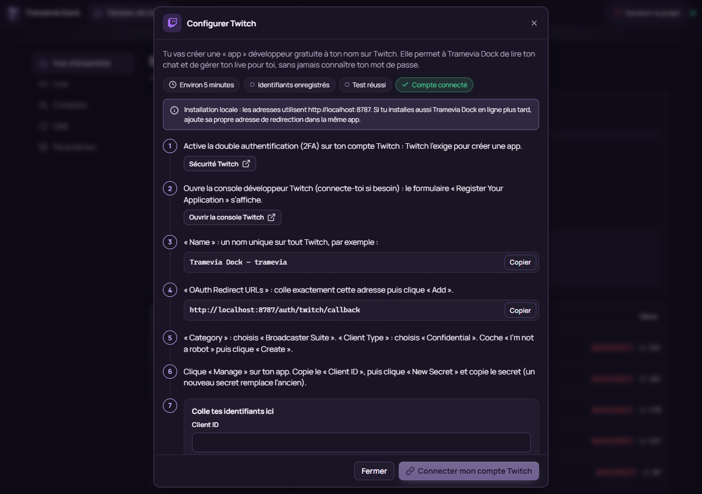
</p>

| Plateforme | Ce que tu fais | Bon à savoir |
|---|---|---|
| **Twitch** | Une app sur la console Twitch, guidée par l’assistant | La double authentification (2FA) doit être activée : l’assistant te donne le lien |
| **Kick** | Une app dans les paramètres développeur de Kick | 2FA obligatoire aussi. En ligne, active **Enable Webhooks** |
| **YouTube** | Un projet Google Cloud et un identifiant OAuth | Google affiche « Cette application n’a pas été validée » : c’est normal, c’est ta propre app |
| **TikTok LIVE** | Rien à créer : tape ton @pseudo et clique sur « Ajouter » | Lecture seule (chat, cadeaux, spectateurs) |

Compte environ **5 minutes par plateforme**. Tu peux connecter plusieurs comptes par plateforme (par exemple deux chaînes Twitch). Le pas-à-pas complet, plateforme par plateforme : [guide des plateformes](docs/fr/platforms.md).

> 💬 **Bloqué ?** « Adresse de redirection refusée », compte « à reconnecter », pas de chat Kick : la [FAQ et dépannage](docs/fr/faq.md#dépannage) reprend les messages d’erreur un par un. Sinon, [pose ta question](https://github.com/Tramevia/Tramevia-Dock/discussions/categories/q-a).

<a id="etape-3"></a>

## 🧱 Étape 3 : ajoute les docks dans OBS

1. Dans le tableau de bord, ouvre **OBS**. La carte « Docks OBS » te donne une adresse par dock : Chat unifié, Événements, Communauté, Infos du live et Tableau de bord.
2. Clique sur « Copier » (1) à côté du dock que tu veux. Commence par le **Chat unifié**.
3. Dans OBS, ouvre le menu **Docks → Docks de navigateur personnalisés…**.
4. Donne un nom au dock à gauche (par exemple « Chat »), colle l’adresse à droite dans la colonne URL, puis clique sur « Appliquer ».
5. Recommence pour chaque dock, puis fais-les glisser où tu veux dans la fenêtre d’OBS. Dans le tableau de bord, clique sur « J’ai ajouté mes docks ».

<p align="center">
  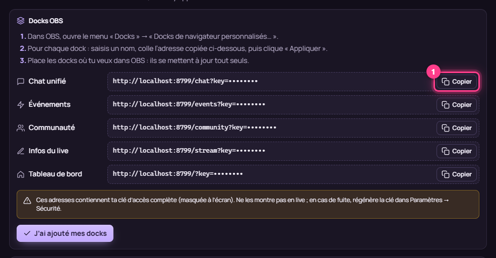
</p>

Chaque dock reste sur sa propre page : pas d’onglets vers les autres pages dans OBS, et tu as une ligne de dock par page.

> [!IMPORTANT]
> Il te faut **OBS Studio 31 ou plus récent** : le navigateur intégré d’OBS 30 est trop ancien pour le dock de chat.

> [!WARNING]
> Ces adresses contiennent ta clé d’accès complète, c’est pour ça qu’elle est masquée à l’écran. **Ne les montre jamais en live** et ne les partage pas (même pas dans une question sur GitHub). En cas de fuite : **Paramètres → Sécurité → Clé des docks → « Régénérer »**, puis recopie les nouvelles adresses dans OBS.

<a id="etape-4"></a>

## 💬 Étape 4 : affiche ton chat sur le stream

Les overlays se règlent dans la même section **OBS**, juste sous les docks, dans la carte « Overlay de chat ». Il y en a quatre, chacun avec ses réglages et **sa propre adresse** : Chat, Message mis en avant, Alertes et Spectateurs. Une source Navigateur dans OBS pour chacun.

1. Dans la carte « Overlay de chat », choisis « Chat », puis un **Thème**. L’« Aperçu en direct » te montre le résultat au fur et à mesure (le damier représente la transparence), et tes réglages s’enregistrent tout seuls.
2. Copie l’« Adresse de l’overlay ».
3. Dans OBS : **Sources → + → Navigateur**, donne un nom à la source, colle l’adresse dans le champ URL, mets la largeur à **400** et la hauteur à **600**, puis valide.

<p align="center">
  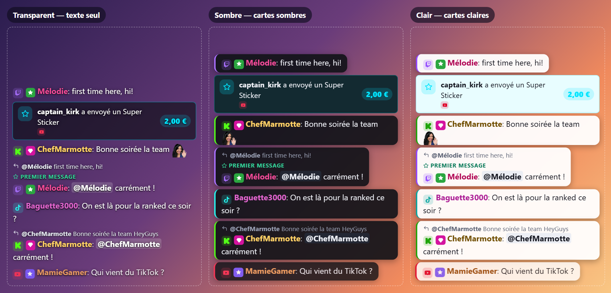
</p>

- **Transparent** : le texte seul, posé directement sur ta scène. Active « Bulles » ou « Contour du texte » si ton fond est chargé.
- **Sombre** : chaque message dans une carte sombre, avec la couleur de sa plateforme. Lisible sur n’importe quel fond.
- **Clair** : chaque message dans une carte claire à texte foncé, avec la couleur de sa plateforme.

Tu colles l’adresse **une seule fois** : quand tu changes un réglage ensuite, l’overlay suit en direct dans OBS. Recolle-la seulement après avoir régénéré la clé de l’overlay, ou changé de port ou de `PUBLIC_URL`. Les overlays utilisent une clé à part, **en lecture seule** : leur adresse ne permet aucune action sur tes comptes.

> [!TIP]
> **Une seule question à l’écran ?** Choisis « Message mis en avant », ajoute son adresse comme deuxième source Navigateur, puis, dans le dock Chat, survole un message et clique sur son étoile « Afficher sur l’overlay ». Tous les réglages : [guide OBS](docs/fr/obs.md).

<a id="alertes"></a>
<a id="etape-5"></a>

## 🔔 Étape 5 : les alertes

Chaque follow, sub, sub offert, don (bits, KICKs, Super Chats, cadeaux TikTok et YouTube), raid, récompense de points, j’aime et partage TikTok s’affiche à l’écran, **une alerte à la fois, toutes plateformes confondues**, avec un petit carillon.

<p align="center">
  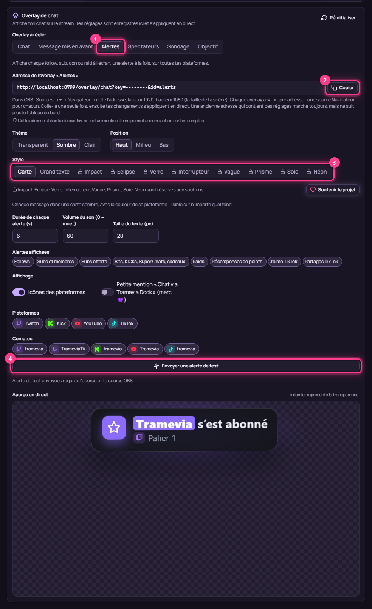
</p>

1. Dans la carte de l’overlay, choisis **Alertes** (1).
2. Copie l’adresse (2). Dans OBS : **Sources → + → Navigateur**, colle-la, et mets la source **à la taille de ta scène** (largeur **1920**, hauteur **1080** pour une scène en 1080p). L’alerte apparaît centrée en **haut**, au **milieu** ou en **bas** de la source, selon ta **Position**.
3. Choisis un **Style** (3). L’aperçu le montre tout de suite.
4. Règle la **durée** de chaque alerte (6 secondes par défaut), le **volume du son** (0 = muet) et la **taille du texte**. Dans « Alertes affichées », désactive celles que tu ne veux pas à l’écran ; dans « Plateformes » et « Comptes », retire ceux que tu ne veux pas.
5. Clique sur **« Envoyer une alerte de test »** (4) : elle s’affiche dans l’aperçu et dans OBS, sans attendre un vrai follow.

### Les 10 styles

<p align="center">
  
</p>

| Style | À quoi ça ressemble | |
|---|---|---|
| **Carte** | Une carte en verre qui flotte en 3D | Gratuit |
| **Grand texte** | De grands mots posés sur ta scène, sans cadre | Gratuit |
| **Impact** | Un plan produit : l’alerte tombe en trois tranches qui tournent, se recollent d’un coup et éclaboussent | Accès anticipé |
| **Éclipse** | Rien que de la lumière : deux plans se croisent sur un anneau, puis deux grandes parois de lumière encadrent le texte | Accès anticipé |
| **Verre** | Une capsule de verre dépoli devient une carte, une lumière chaude passe dessous | Accès anticipé |
| **Interrupteur** | Un interrupteur bascule sur ON au son, la lumière jaillit et des points lumineux décomptent le temps | Accès anticipé |
| **Vague** | Une vague de particules blanches déferle, le texte se forme dans la poussière | Accès anticipé |
| **Prisme** | Des barres de cristal sur un sol de verre noir, qui bondissent sur chaque note comme un égaliseur | Accès anticipé |
| **Soie** | Des voiles de fils très fins tissent une sphère autour de l’icône | Accès anticipé |
| **Néon** | Ton pseudo en grosses lettres chromées sur un anneau qui tourne, éclairé au néon | Accès anticipé |

**Carte** et **Grand texte** sont gratuits pour tout le monde. Les huit autres sont en **accès anticipé (Soon)** : réservés aux soutiens à partir de la 1.4.5, puis gratuits pour tous. Date de déblocage :  **Soon** 😎. Un style verrouillé affiche un cadenas ; si tu le choisis, l’overlay affiche « Carte » à la place. Plus de détails dans [Soutenir](#soutenir).

> [!TIP]
> **Le carillon ne s’entend pas sur le stream ?** Dans les propriétés de la source Navigateur, coche « Contrôler l’audio via OBS », et vérifie que la source n’est pas coupée dans le mixeur audio. Les alertes s’affichent seulement au moment où elles arrivent : quand OBS recharge la source, les anciennes ne repassent pas.

<a id="etape-6"></a>

## 👁️ Étape 6 : le compteur de spectateurs

<p align="center">
  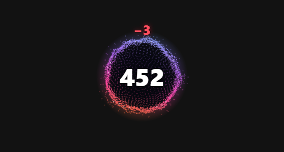
</p>

Un orbe de particules lumineuses avec le **total de tes spectateurs en direct sur toutes tes plateformes**. Quand il monte, un **+x** vert s’anime ; quand il baisse, un **−x** rouge.

1. Dans la carte de l’overlay, choisis **Spectateurs** et copie son adresse.
2. Dans OBS : **Sources → + → Navigateur**, colle l’adresse, largeur **400**, hauteur **400**. Garde la source à 100 % de sa taille pour un chiffre bien net.
3. **Nombre** : dans l’orbe (« Au centre »), ou à sa gauche ou à sa droite. Dans « Plateformes » et « Comptes », retire ceux que tu ne veux pas compter.
4. Clique sur **« Tester une variation »** pour voir une hausse puis une baisse.

Le total suit le relevé des plateformes, toutes les 30 à 60 secondes environ.

<a id="etape-7"></a>

## 🏷️ Étape 7 : avant chaque live, titre, catégorie et tags partout

1. Ouvre le dock « Infos du live » (ou l’onglet du même nom dans ton navigateur) et vérifie les comptes cochés.
2. Clique sur « Charger les infos actuelles » : le formulaire se remplit, rien n’est envoyé.
3. Change le **Titre**, cherche ta **Catégorie** une seule fois (chaque plateforme est cherchée, jaquettes à l’appui) et ajoute tes **Tags**.
4. Clique sur « Aperçu des changements » pour voir l’avant et l’après, puis sur « Appliquer à … comptes ». Tu as un résultat par chaîne, et un bouton pour réessayer seulement les échecs.

<p align="center">
  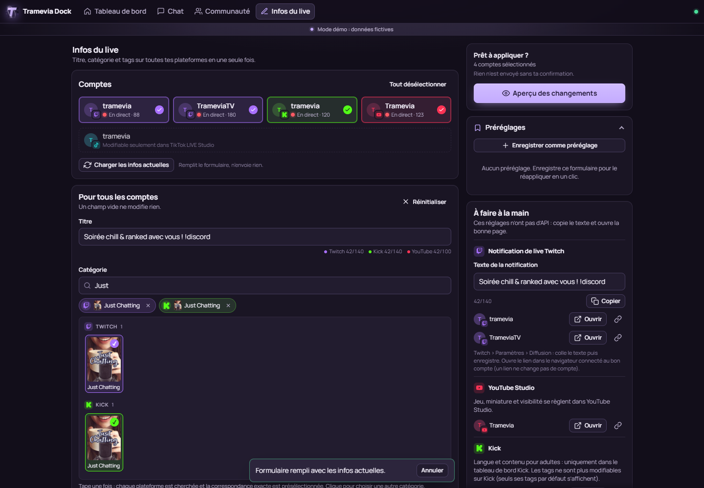
</p>

Ce que les plateformes ne permettent pas de changer à distance (le texte de notification de live Twitch, le « Jeu » YouTube…) t’attend dans la rubrique « À faire à la main », avec le texte à copier et le bon lien. Sur **YouTube**, le titre appartient à un direct précis : programme d’abord ton live dans YouTube Studio (ou lance-le). Sur **TikTok**, le titre se change uniquement dans l’app TikTok ou LIVE Studio.

> [!TIP]
> Tu fais souvent le même genre de live ? Clique sur « Enregistrer comme préréglage » (par exemple « Soirée ranked ») : la prochaine fois, un clic remplit tout le formulaire, et il ne te reste qu’à appliquer.

**Et voilà, tout est prêt. Bon live !** 🎉 Une question, une idée, envie de montrer ton setup ? [Rejoins les Discussions](https://github.com/Tramevia/Tramevia-Dock/discussions).

<a id="fonctionnalites"></a>

## ✨ Fonctionnalités

<table>
  <tr>
    <td width="50%" align="center" valign="top">
      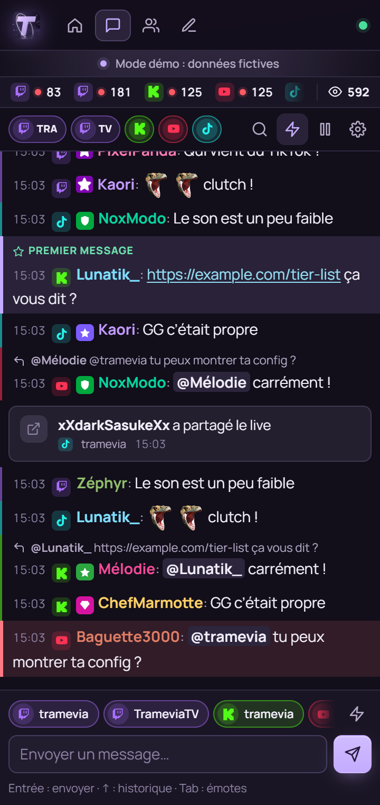<br>
      <b>💬 Chat unifié</b><br>
      <sub>Lecture, envoi multi-comptes, réponses et modération</sub>
    </td>
    <td width="50%" align="center" valign="top">
      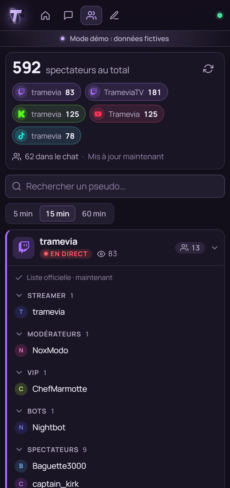<br>
      <b>👥 Communauté</b><br>
      <sub>Total de spectateurs et qui est dans ton chat</sub>
    </td>
  </tr>
  <tr>
    <td width="50%" align="center" valign="top">
      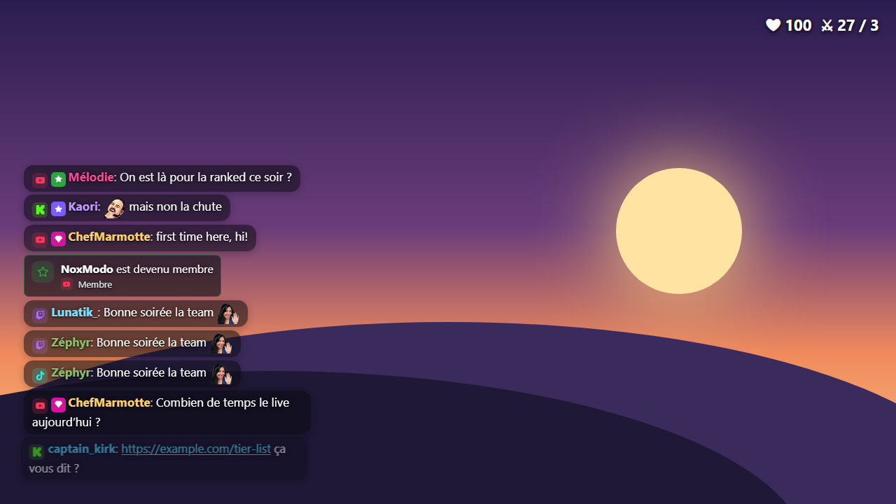<br>
      <b>📺 Overlay de chat</b><br>
      <sub>Ton chat sur le stream, sans une ligne de CSS</sub>
    </td>
    <td width="50%" align="center" valign="top">
      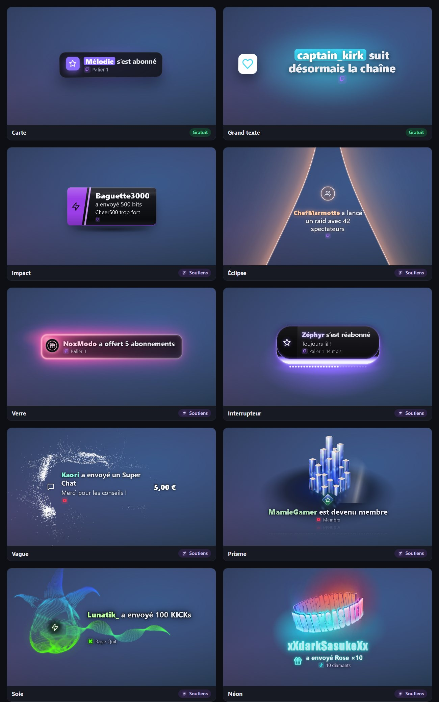<br>
      <b>🔔 Alertes</b><br>
      <sub>Toutes tes plateformes, 10 styles animés</sub>
    </td>
  </tr>
  <tr>
    <td width="50%" align="center" valign="top">
      <br>
      <b>🏷️ Infos du live</b><br>
      <sub>Titre, catégorie et tags sur toutes tes chaînes</sub>
    </td>
    <td width="50%" align="center" valign="top">
      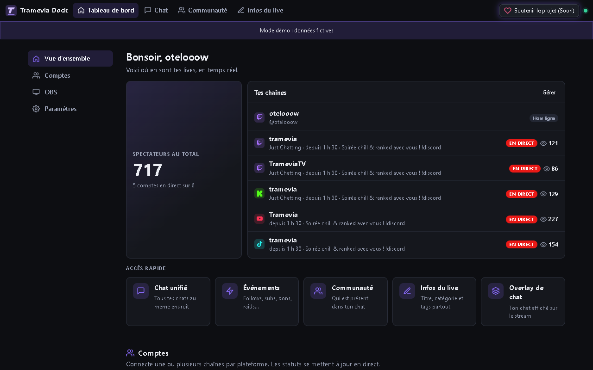<br>
      <b>🏠 Tableau de bord</b><br>
      <sub>Tes chaînes en direct, tes comptes, OBS et les paramètres</sub>
    </td>
  </tr>
</table>

<details>
<summary><b>📋 La liste complète des fonctionnalités</b></summary>

**💬 Chat et événements**

- Chat unifié de tous tes comptes, avec filtre par compte, recherche, pause automatique au survol et pastille « N nouveaux messages ».
- Émotes natives, plus 7TV, BTTV et FFZ selon la plateforme. Badges, cheermotes Twitch, liens et mentions.
- Envoi sur plusieurs comptes à la fois (« Envoyer sur »), réponses, historique avec ↑ et autocomplétion des émotes avec Tab.
- Modération depuis le chat (supprimer, exclure temporairement, bannir, débannir), dans la limite de ce que chaque plateforme permet.
- Fiche utilisateur : ses messages de la session et, sur Twitch, la date de création du compte et de follow.
- Premiers messages, mentions et mots-clés mis en évidence, avec un son facultatif quand on te mentionne.
- Fil d’événements : follows, abonnements, abonnements offerts, Bits, KICKs, Super Chats, Super Stickers, adhésions, Jewels, raids, points de chaîne, cadeaux TikTok…
- Marqueur et clip Twitch en un clic.

**👥 Communauté**

- Nombre total de spectateurs, et le détail par chaîne.
- Sur Twitch, la liste officielle des personnes présentes dans le chat, rangées par rôle (streamer, modérateurs, VIP, bots).
- Sur Kick, YouTube et TikTok, qui ne fournissent pas cette liste : les personnes actives ces 5, 15 ou 60 dernières minutes.

**🏷️ Infos du live**

- Titre, catégorie et tags sur tous tes comptes en une fois, avec personnalisation compte par compte.
- Une seule recherche de catégorie pour toutes les plateformes, avec les jaquettes.
- Les réglages propres à chaque plateforme : langue, classification du contenu et contenu de marque sur Twitch ; description et catégorie sur YouTube.
- Préréglages réutilisables, aperçu des changements avant envoi, résultat par compte et bouton pour réessayer seulement les échecs.
- Une rubrique « À faire à la main » pour ce qui n’a pas d’API, avec le texte à copier et le bon lien.

**🖼️ Overlays**

- Quatre overlays pour des sources Navigateur d’OBS, réglés dans le tableau de bord avec un aperçu en direct : les réglages s’appliquent en direct, chaque adresse se colle une seule fois dans OBS.
- **Chat** : trois thèmes (Transparent, Sombre, Clair), taille, disparition, bulles, contour, badges, avatars, filtres par plateforme et par compte.
- **Message mis en avant** : tu choisis un message dans le dock Chat, il s’affiche à l’écran.
- **Alertes** : follows, subs, subs offerts, dons, raids, récompenses, j’aime et partages TikTok de toutes tes plateformes, une alerte à la fois, avec un carillon, 10 styles et un bouton de test.
- **Spectateurs** : le total de tes spectateurs en direct sur toutes tes plateformes, chaque hausse (+x, en vert) et chaque baisse (−x, en rouge) animée.

**🛡️ Installation et sécurité**

- Assistant pas à pas pour chaque plateforme, avec les adresses exactes à copier et un bouton « Tester ».
- Plusieurs comptes par plateforme (par exemple deux chaînes Twitch).
- Jetons chiffrés sur le disque, mot de passe obligatoire dès que l’app est joignable depuis le réseau, clés d’accès régénérables pour les docks et l’overlay.
- En local sur Windows, macOS ou Linux, ou en ligne avec Railway (en un clic) ou Docker. Mises à jour en un clic ou automatiques. Interface en français et en anglais.

</details>

## 📡 Plateformes prises en charge

**En bref :** tout marche sur Twitch, presque tout sur Kick et YouTube, et TikTok est en lecture seule (tu lis ton chat, sans pouvoir y écrire).

Légende : ✅ officiel · 🟡 officiel mais limité · ⚠️ non officiel · ❌ impossible

| | Twitch | Kick | YouTube | TikTok LIVE |
|---|---|---|---|---|
| Lire le chat | ✅ | ✅ webhooks (en ligne)<br>⚠️ Pusher (en local) | ✅ | ⚠️ lecture seule |
| Envoyer des messages | ✅ 500 car. | ✅ 500 car. | 🟡 200 car., 50 unités de quota par message | ❌ |
| Répondre à un message | ✅ | ✅ | ❌ | ❌ |
| Modération (supprimer, exclure, bannir, débannir) | ✅ exclusion de 1 s à 14 j | ✅ exclusion de 1 min à 7 j | 🟡 50 unités par action, exclusion jusqu’à 24 h, débannissement limité | ❌ |
| Qui est dans le chat | ✅ liste officielle, avec les rôles | 🟡 personnes actives | 🟡 personnes actives | ⚠️ personnes actives |
| Spectateurs et statut du live | ✅ | ✅ | ✅ sauf si tu masques le compteur | ⚠️ |
| Titre | ✅ 140 car. | ✅ | ✅ 100 car., sur un direct en cours ou programmé | ❌ app TikTok ou LIVE Studio |
| Catégorie | ✅ recherche et jaquettes | ✅ recherche et jaquettes | 🟡 liste fixe, le « Jeu » se règle dans YouTube Studio | ❌ |
| Tags | ✅ 10 tags de 25 car. | ❌ plus modifiables sur Kick | ✅ 500 car. au total | ❌ |
| Événements et alertes | ✅ follows, abonnements, Bits, raids, points de chaîne | ✅ webhooks<br>⚠️ Pusher<br>follows, abonnements, KICKs, récompenses | 🟡 Super Chats, Super Stickers, adhésions, Jewels ; ni follows ni abonnements | ⚠️ cadeaux, follows, partages, abonnements, likes |
| Marqueur et clip | ✅ | ❌ | ❌ | ❌ |

> [!NOTE]
> **Bon à savoir**
>
> - **TikTok LIVE** n’a pas d’API pour les lives. Tramevia Dock lit ton chat, tes cadeaux et tes spectateurs en **lecture seule**, via la bibliothèque non officielle [tiktok-live-connector](https://github.com/zerodytrash/TikTok-Live-Connector) et le serveur de signature d’Euler Stream. Ça peut cesser de fonctionner après une mise à jour de TikTok.
> - **Kick en local** : le chat passe par le socket Pusher non officiel qu’utilise kick.com lui-même. Les webhooks officiels demandent une adresse publique en HTTPS, donc une installation en ligne. L’envoi de messages, la modération et les infos du live passent par l’API officielle dans les deux cas.
> - **YouTube** : chaque action consomme du quota (10 000 unités par jour et par projet Google Cloud). Tramevia Dock affiche une estimation et met l’envoi en pause avant la limite.
> - Aucune plateforme ne permet de modifier le texte de notification de live par API. Pour Twitch, le dock « Infos du live » te prépare le texte et le lien vers la bonne page.

Le détail plateforme par plateforme est dans le [guide des plateformes](docs/fr/platforms.md).

<a id="autres-installations"></a>

## 🧰 Autres façons d’installer

<details>
<summary><b>🐳 Docker</b></summary>

Il te faut Docker avec Compose. Pas besoin du code : l’image prête à l’emploi `ghcr.io/tramevia/tramevia-dock` est publiée à chaque version. Dans un nouveau dossier, mets [`compose.yaml`](compose.yaml) et un fichier `.env` avec au minimum :

```env
ADMIN_PASSWORD=choisis-un-mot-de-passe-long
```

puis lance :

```bash
docker compose up -d
```

Ouvre <http://localhost:8787> et connecte-toi avec ton mot de passe. Dans Docker, le mot de passe est **obligatoire, même en local** (12 caractères minimum). Tes données vivent dans un volume monté sur `/data`.

Pour mettre à jour : `docker compose pull && docker compose up -d` (ou active la mise à jour automatique de nuit, facultative). Journaux, mises à jour automatiques et `docker run` : [guide de l’hébergement en ligne](docs/fr/cloud.md#docker-compose).

</details>

<details>
<summary><b>☁️ Railway à la main, ton propre serveur ou un tunnel</b></summary>

Tu préfères régler Railway toi-même plutôt que d’utiliser le bouton ? Déploie l’image Docker `ghcr.io/tramevia/tramevia-dock` avec un numéro de version complet, ajoute un volume sur **`/data`**, les variables **`ADMIN_PASSWORD`**, **`RAILWAY_RUN_UID=0`** et **`PORT=8787`**, génère un domaine sur le port 8787 et active les **Auto Updates**. Le pas-à-pas en 8 étapes est dans le [guide de l’hébergement en ligne](docs/fr/cloud.md#railway).

N’importe quel hébergeur qui fait tourner une image Docker avec un volume persistant sur `/data` et du HTTPS devant convient aussi. En ligne, `ADMIN_PASSWORD` est obligatoire (12 caractères minimum), et les adresses de redirection commencent par ton adresse publique : ajoute-les à tes apps.

Tu veux les webhooks officiels de Kick sans serveur ? Un tunnel (Cloudflare Tunnel, ngrok…) devant ton installation locale suffit : voir [En local avec un tunnel](docs/fr/cloud.md#en-local-avec-un-tunnel-webhooks-kick). Reverse proxy et sauvegardes : [guide de l’hébergement en ligne](docs/fr/cloud.md).

</details>

<a id="mises-a-jour"></a>

## 🔄 Mises à jour

Tramevia Dock vérifie une fois par jour si une nouvelle version est sortie, et te prévient sur le tableau de bord. Tes comptes, tes réglages et tes docks OBS restent exactement comme avant.

- 💻 **Installation ZIP** : clique sur « Installer maintenant » dans le message. Tramevia Dock redémarre tout seul en quelques secondes, jamais pendant un live, et revient à la version précédente si la nouvelle ne démarre pas. Tu préfères ne rien faire ? Active l’installation automatique dans **Paramètres → À propos**.
- ☁️ **Railway** : avec le bouton Deploy on Railway, les nouvelles versions s’installent toutes seules la nuit. Installé à la main ? Active une fois les **Auto Updates** de Railway.
- 🐳 **Docker** : `docker compose pull && docker compose up -d`, ou active la mise à jour automatique de nuit (facultative).

Installé avec `git clone` ? Lance `git pull` puis relance-le. Tous les détails : [Mettre à jour](docs/fr/install.md#mettre-à-jour). Les nouveautés de chaque version sont annoncées dans les [Discussions → Announcements](https://github.com/Tramevia/Tramevia-Dock/discussions/categories/announcements).

> [!NOTE]
> **Sûr par conception.** Les mises à jour viennent uniquement des versions officielles de ce dépôt. Chaque téléchargement est vérifié (taille et empreinte SHA-256) avant de remplacer quoi que ce soit, et ton dossier `data` et ton fichier `.env` ne sont jamais touchés. L’installation automatique reste **désactivée** tant que tu ne l’actives pas. La vérification quotidienne apprend seulement à GitHub ton adresse IP et ton numéro de version. Tu n’en veux pas ? Désactive-la dans **Paramètres → À propos**, ou mets `UPDATE_CHECK=0`. Le fonctionnement : [SECURITY.md](SECURITY.md#updates--mises-à-jour).

<a id="faq"></a>

## ❓ FAQ

<details>
<summary><b>C’est vraiment gratuit ?</b></summary>

Oui. Tramevia Dock est gratuit et libre. Les apps développeur de Twitch, Kick et Google sont gratuites, l’API YouTube aussi dans la limite du quota quotidien, et l’offre gratuite d’Euler Stream suffit en général pour TikTok. Seul un hébergement en ligne (Railway, serveur…) peut te coûter quelque chose ; sur ton PC, tout est gratuit. Les styles d’alertes en accès anticipé deviennent gratuits pour tous après leur période réservée aux soutiens.

</details>

<details>
<summary><b>Il faut savoir coder ?</b></summary>

Non. Tu double-cliques sur un fichier (ou tu cliques sur un bouton pour Railway), et l’assistant te guide clic par clic, avec des boutons « Copier » pour tout ce qu’il faut coller. L’étape la plus technique, c’est la création de l’app développeur sur chaque plateforme : environ 5 minutes, guidées de bout en bout. Les réglages avancés (fichier `.env`) sont facultatifs en local.

</details>

<details>
<summary><b>PC ou Railway, lequel choisir ?</b></summary>

Commence sur ton PC : c’est gratuit et ça marche très bien tant que ton PC est allumé pendant tes lives. Passe sur Railway si tu veux ouvrir tes docks depuis plusieurs appareils, garder le chat et les événements suivis PC éteint, ou lire le chat Kick par les webhooks officiels. Le tableau complet : [Étape 0](#choisir). Les deux installations sont indépendantes : sur Railway, tu reconnectes tes comptes.

</details>

<details>
<summary><b>C’est sûr ? Où sont stockés mes mots de passe ?</b></summary>

Tramevia Dock ne voit jamais le mot de passe de tes comptes : tu te connectes sur la page officielle de chaque plateforme, qui lui donne ensuite un accès. Il ne demande jamais ta clé de stream non plus.

Ces accès (les « jetons ») et les secrets de tes apps sont chiffrés sur ton disque, dans le dossier `data`. Sans mot de passe, le tableau de bord n’est accessible que depuis ton ordinateur. Ta part du travail : ne montre pas les adresses des docks en live, et ne partage ni ton dossier `data` ni ton `.env`. Plus de détails dans [Sécurité et confidentialité](#sécurité-et-confidentialité).

</details>

<details>
<summary><b>Pourquoi certains styles d’alertes ont un cadenas ?</b></summary>

**Carte** et **Grand texte** sont gratuits pour tout le monde. Les huit autres styles sont en accès anticipé : à partir de la 1.4.5, un code soutien les débloque en avance, puis ils deviennent gratuits pour tous. Date de déblocage :  **Soon** 😎. D’ici là, un style verrouillé s’affiche comme « Carte ». Voir [Soutenir](#soutenir).

</details>

<details>
<summary><b>Les alertes ou le compteur ne s’affichent pas dans OBS</b></summary>

Vérifie dans l’ordre :

1. La fenêtre de Tramevia Dock est ouverte (en local), ou le service Railway est vert (en ligne).
2. L’adresse collée dans OBS est bien celle de l’overlay choisi (chaque overlay a la sienne : `id=alerts` pour les alertes, `id=viewers` pour le compteur).
3. La source Alertes a la taille de ta scène (par exemple 1920 × 1080) et n’est pas masquée par une autre source au-dessus d’elle.
4. « Envoyer une alerte de test » l’affiche dans l’aperçu du tableau de bord : si oui, mais pas dans OBS, clic droit sur la source → « Actualiser ».
5. Le type d’alerte, la plateforme et le compte sont bien cochés dans les réglages de l’overlay.

Toujours rien ? [Pose ta question](https://github.com/Tramevia/Tramevia-Dock/discussions/categories/q-a) avec ta version d’OBS et de Tramevia Dock.

</details>

<details>
<summary><b>Ça marche avec Streamlabs ou un autre logiciel qu’OBS ?</b></summary>

Tramevia Dock est pensé pour **OBS Studio 31 ou plus récent** et ses docks de navigateur personnalisés. Le tableau de bord et les docks sont de simples pages web : tu peux aussi les ouvrir dans ton navigateur, à côté de n’importe quel logiciel. Les overlays sont des adresses prévues pour une source Navigateur d’OBS ; les autres logiciels de stream ne sont pas testés.

</details>

<details>
<summary><b>Pourquoi TikTok est « non officiel » ?</b></summary>

TikTok ne propose aucune API pour les lives. Tramevia Dock passe donc par la bibliothèque non officielle [tiktok-live-connector](https://github.com/zerodytrash/TikTok-Live-Connector), qui se branche sur le même flux que l’app TikTok. C’est en **lecture seule** : chat, cadeaux, follows, spectateurs… mais pas d’envoi de messages, pas de modération et pas de titre. Et ça peut cesser de fonctionner après une mise à jour de TikTok, jusqu’à la prochaine version de Tramevia Dock.

</details>

<details>
<summary><b>Le chat Kick marche en local ?</b></summary>

Oui. Kick ne propose officiellement le chat en temps réel que par webhooks, qui demandent une adresse publique en HTTPS. Sur ton PC, Tramevia Dock utilise donc le socket Pusher, celui qu’utilise kick.com lui-même : ça marche, mais c’est non officiel. L’envoi de messages, la modération et le titre passent toujours par l’API officielle.

Si le chat ne se connecte pas, tu peux saisir le numéro de ton salon de chat à la main dans **Comptes → ton compte Kick → « Options »**. Voir [comment le chat Kick est lu](docs/fr/platforms.md#comment-le-chat-kick-est-lu).

</details>

<details>
<summary><b>C’est quoi, le quota YouTube ?</b></summary>

Google accorde **10 000 unités par jour** à chaque projet Google Cloud. Envoyer un message coûte 50 unités, une action de modération aussi, et changer le titre environ 51. Une journée avec un live de 4 heures consomme environ 830 unités sans compter tes messages ; 40 messages envoyés, c’est 2 000 unités de plus.

Tramevia Dock affiche une estimation sur ta carte de compte (« Quota API : … unités ») et met l’envoi, la modération et la modification des infos en pause à 95 % de la limite, jusqu’à minuit heure du Pacifique (vers 9 h du matin en France). Voir [le quota quotidien](docs/fr/platforms.md#le-quota-quotidien).

</details>

<details>
<summary><b>Je peux l’utiliser sur deux PC ?</b></summary>

Oui, de deux façons :

- **Une seule installation, plusieurs appareils** : fais tourner Tramevia Dock en ligne (Railway) ou sur un PC, et ouvre-le depuis l’autre. Il faut alors un `ADMIN_PASSWORD`. Voir [l’hébergement en ligne](docs/fr/cloud.md#autres-hébergeurs-et-reverse-proxy), paragraphe « Depuis un autre appareil de ton réseau local ».
- **Une installation par PC** : chaque installation est indépendante, avec ses propres comptes et réglages. Tu connectes tes comptes sur chacune ; la même app Twitch et le même client Google peuvent servir aux deux. Le quota YouTube de ton projet Google est alors partagé, et chaque installation ne compte que sa propre consommation.

Tu changes simplement de PC ? Copie le dossier `data` en entier, avec `secret.key` : voir [J’ai changé de PC](docs/fr/faq.md#jai-changé-de-pc).

</details>

D’autres questions ? La [FAQ et dépannage](docs/fr/faq.md) reprend les messages d’erreur un par un, et les [Discussions](https://github.com/Tramevia/Tramevia-Dock/discussions/categories/q-a) sont là pour tout le reste.

📚 Les guides complets : [Installation](docs/fr/install.md) · [Plateformes](docs/fr/platforms.md) · [OBS](docs/fr/obs.md) · [En ligne](docs/fr/cloud.md) · [FAQ](docs/fr/faq.md)

<a id="aide"></a>

## 💬 Besoin d’aide ? Pose tes questions

**N’hésite pas à poser tes questions dans les [GitHub Discussions](https://github.com/Tramevia/Tramevia-Dock/discussions) du projet.** Il n’y a pas de question bête : si tu bloques, d’autres bloquent sûrement au même endroit, et ta question aide tout le monde. Tu peux écrire en français ou en anglais.

| Tu veux… | Va ici |
|---|---|
| 🙋 Poser une question, demander de l’aide pour l’installation ou OBS | [Discussions → Q&A](https://github.com/Tramevia/Tramevia-Dock/discussions/categories/q-a) |
| 💡 Proposer une idée ou une fonctionnalité | [Discussions → Ideas](https://github.com/Tramevia/Tramevia-Dock/discussions/categories/ideas) |
| 🎬 Montrer ton setup, ta scène, tes alertes | [Discussions → Show and tell](https://github.com/Tramevia/Tramevia-Dock/discussions/categories/show-and-tell) |
| 📣 Suivre les nouvelles versions | [Discussions → Announcements](https://github.com/Tramevia/Tramevia-Dock/discussions/categories/announcements) |
| 🗳️ Donner ton avis sur la suite | [Discussions → Polls](https://github.com/Tramevia/Tramevia-Dock/discussions/categories/polls) |
| 🐛 Signaler un bug précis et reproductible | [Issues](https://github.com/Tramevia/Tramevia-Dock/issues) |
| 🔒 Signaler une faille de sécurité | En privé, comme expliqué dans [SECURITY.md](SECURITY.md) (pas d’issue publique) |

**Pour qu’on t’aide vite, indique dans ta question :**

- ta version de Tramevia Dock (**Paramètres → À propos**) et d’OBS ;
- ton installation : PC Windows, macOS, Linux, Railway ou Docker ;
- la plateforme concernée (Twitch, Kick, YouTube, TikTok) ;
- ce que tu as fait, ce que tu attendais, et ce qui s’est passé, avec le message d’erreur exact ou une capture d’écran.

> [!CAUTION]
> **Ne colle jamais** une adresse de dock ou d’overlay complète (elle contient ta clé), ton `ADMIN_PASSWORD`, un Client Secret, ton fichier `.env` ou ton dossier `data`. Sur une capture, vérifie que la clé est bien masquée (`key=••••••••`).

<a id="sécurité-et-confidentialité"></a>

## 🔒 Sécurité et confidentialité

- **Aucune donnée collectée.** Pas de télémétrie, pas de statistiques d’usage, pas de pub, pas de compte chez nous. Ton chat, tes stats, tes jetons et tes réglages ne nous sont jamais envoyés : il n’existe aucun serveur Tramevia pour les recevoir. Le code est ouvert, tout le monde peut le vérifier.
- **Hébergé chez toi.** Tes jetons ne quittent ton PC (ou ton serveur) que pour parler aux plateformes elles-mêmes.
- **Jamais tes mots de passe.** Tu te connectes sur la page officielle de chaque plateforme. Tramevia Dock ne voit ni ton mot de passe ni ta clé de stream.
- **Chiffré.** Les jetons d’accès et les secrets de tes apps sont chiffrés sur le disque (AES-256-GCM), avec la clé `TOKEN_KEY` ou le fichier `data/secret.key` créé au premier lancement. Une copie de la base seule est illisible sans cette clé. Garde une copie de ce fichier (ou mets `TOKEN_KEY` dans ton gestionnaire de mots de passe).
- **Local par défaut.** Sans `ADMIN_PASSWORD`, le serveur n’écoute que sur `127.0.0.1` et ne répond qu’à ton ordinateur. Dès que Tramevia Dock est joignable depuis le réseau (en ligne, réseau local, tunnel), `ADMIN_PASSWORD` est obligatoire, avec 12 caractères minimum, et les tentatives de connexion sont limitées.
- **Clés d’accès.** Les adresses des docks contiennent une clé d’accès complet ; celles des overlays, une clé séparée en lecture seule. Traite-les comme des mots de passe : tu peux les régénérer dans **Paramètres → Sécurité**.
- **Protégé des autres sites.** Une page web que tu visites ne peut ni lire ni piloter ton Tramevia Dock : les requêtes venant d’autres sites sont refusées.
- **Codes soutien vérifiés hors ligne.** Un code soutien est vérifié par une signature, directement dans Tramevia Dock : rien n’est envoyé nulle part pour le valider.
- **Déconnecter** un compte efface ses jetons, et Tramevia Dock essaie aussi de révoquer son accès auprès de la plateforme.
- **Mises à jour vérifiées.** Uniquement les versions officielles de ce dépôt, contrôlées par SHA-256 avant de remplacer quoi que ce soit (voir [Mises à jour](#mises-a-jour)).

> [!TIP]
> **PC perdu ou volé, ou dossier `data` partagé par erreur ?** Retire l’accès de Tramevia Dock dans les réglages de compte de chaque plateforme (par exemple [Twitch → Connexions](https://www.twitch.tv/settings/connections) et les [autorisations de ton compte Google](https://security.google.com/settings/security/permissions)), puis crée un nouveau Client Secret pour tes apps développeur. Les jetons copiés ne marchent alors plus.

<details>
<summary><b>Le détail : ce qui est enregistré, et ce qui sort de ton PC</b></summary>

**Données enregistrées** (dans `data/tramevia-dock.db`) : tes réglages, ceux des overlays, tes préréglages, les identifiants chiffrés de tes apps, les clés des docks et de l’overlay, et pour chaque compte connecté son pseudo, son avatar, les permissions accordées et ses jetons chiffrés. S’y ajoutent les identifiants des personnes qui ont déjà écrit dans ton chat (pour repérer les premiers messages), ceux des bannissements YouTube faits depuis Tramevia Dock (pour pouvoir les lever), un compteur de quota YouTube et le numéro de ton salon de chat Kick. Les messages du chat et les événements restent en mémoire uniquement (les 400 derniers) et ne sont pas écrits sur le disque.

**Connexions sortantes** : les plateformes elles-mêmes (Twitch, Kick, Google/YouTube, TikTok), le socket Pusher qu’utilise kick.com (chat Kick en mode non officiel), les services d’émotes 7TV, BTTV et FFZ (avec l’identifiant de ta chaîne), le serveur de signature Euler Stream pour TikTok, et GitHub une fois par jour pour vérifier s’il existe une nouvelle version (désactivable dans **Paramètres → À propos**, ou avec `UPDATE_CHECK=0`). À part les plateformes que tu connectes, aucun de ces services ne reçoit tes jetons ni tes mots de passe.

</details>

**YouTube.** Tramevia Dock utilise les services d’API YouTube. En connectant ta chaîne, tu acceptes les [Conditions d’utilisation de YouTube](https://www.youtube.com/t/terms) ; les données sont traitées selon les [Règles de confidentialité de Google](https://policies.google.com/privacy). Tu peux retirer l’accès à tout moment depuis la [page des autorisations de ton compte Google](https://security.google.com/settings/security/permissions), ou avec le bouton « Déconnecter » du tableau de bord.

**Une faille de sécurité ?** Suis [SECURITY.md](SECURITY.md) et merci de ne pas ouvrir d’issue publique.

<a id="soutenir"></a>

## 💜 Soutenir Tramevia Dock (Soon)

> [!TIP]
> **Tramevia Dock est gratuit et le restera : pas de pub, pas d’abonnement.**
> Il est fait par un streamer, pour les streamers. S’il te fait gagner du temps avant chaque live, le soutenir aide le projet à vivre et à grandir.

**Comment ça marchera (à partir de la 1.4.5) :**

1. Tu soutiens le projet sur [GitHub Sponsors](https://github.com/sponsors/Tramevia).
2. Tu reçois un **code soutien** personnel.
3. Tu le colles dans **Paramètres → À propos** : les styles d’alertes en accès anticipé se débloquent aussitôt, sans connexion à un serveur (le code est vérifié hors ligne).

Chaque style en accès anticipé devient ensuite **gratuit pour tout le monde**. Date de déblocage :  **Soon** 😎. **Carte** et **Grand texte** restent gratuits pour tous, dès maintenant.

<p align="center">
  <a href="https://github.com/sponsors/Tramevia"></a>
</p>

<p align="center"><sub>Pas de budget ? Mettre une étoile ⭐ au dépôt, en parler à un autre streamer, <a href="https://github.com/Tramevia/Tramevia-Dock/discussions/categories/show-and-tell">montrer ton setup</a> ou signaler un bug aide beaucoup aussi.</sub></p>

## 🤝 Contribuer, licence et crédits

**Contribuer.** Les idées, les rapports de bugs et les contributions sont les bienvenus ! Une idée ? Lance-la dans les [Discussions → Ideas](https://github.com/Tramevia/Tramevia-Dock/discussions/categories/ideas). Avant de proposer un changement de code, lis [CONTRIBUTING.md](CONTRIBUTING.md). Pour bidouiller sans aucun compte, `npm run demo` lance le mode démo et `npm test` lance les tests.

[Discussions](https://github.com/Tramevia/Tramevia-Dock/discussions) · [Signaler un problème](https://github.com/Tramevia/Tramevia-Dock/issues) · [Journal des versions](CHANGELOG.md)

**Licence.** [AGPL-3.0](LICENSE). En clair : tu peux utiliser, étudier, modifier et partager Tramevia Dock librement. Si tu distribues une version modifiée, ou si tu la fais tourner pour d’autres personnes à travers un réseau, tu dois partager ton code source sous la même licence, et garder la mention de copyright.

**Copyright © 2026 Tramevia.** Le nom et le logo Tramevia ne sont pas couverts par la licence (AGPL-3.0, section 7e) : une version modifiée que tu distribues ou héberges doit utiliser son propre nom et son propre logo.

**Crédits.**

- [tiktok-live-connector](https://github.com/zerodytrash/TikTok-Live-Connector) pour la lecture des lives TikTok (AGPL-3.0)
- [ws](https://github.com/websockets/ws) pour les WebSockets
- [Simple Icons](https://simpleicons.org) pour les icônes des plateformes (CC0)
- [7TV](https://7tv.app), [BetterTTV](https://betterttv.com) et [FrankerFaceZ](https://www.frankerfacez.com) pour leurs émotes

---

<sub>Tramevia Dock est un projet indépendant. Il n’est ni affilié à Twitch, Kick, YouTube, Google ou TikTok, ni approuvé ou sponsorisé par eux. Ces noms et logos sont des marques de leurs propriétaires respectifs ; les icônes servent uniquement à identifier les plateformes.</sub>

<p align="center"><a href="#top">↑ Retour en haut</a></p>
