<p align="right"><a href="README.fr.md">🇫🇷 Français</a></p>

<a id="top"></a>

<p align="center">
  
</p>

<h1 align="center">Tramevia Dock</h1>

<p align="center">
  <b>All your chats, all your alerts, all your stream info, one tidy place in OBS.</b><br>
  Twitch, Kick, YouTube and TikTok LIVE together, on your own PC or online. Free, and you don't need to know how to code.
</p>

<p align="center">
  <a href="LICENSE"></a>
  
  <a href="CHANGELOG.md"></a>
  
  
  <a href="https://github.com/Tramevia/Tramevia-Dock/discussions"></a>
</p>

<p align="center">
  <a href="#choose"><b>Install</b></a> ·
  <a href="#tutorial-pc"><b>PC tutorial</b></a> ·
  <a href="#tutorial-railway"><b>Railway tutorial</b></a> ·
  <a href="#alerts"><b>Alerts</b></a> ·
  <a href="#features"><b>Features</b></a> ·
  <a href="#faq"><b>FAQ</b></a> ·
  <a href="#help"><b>💬 Help</b></a> ·
  <a href="#support"><b>💜 Support (Soon)</b></a>
</p>

<p align="center">
  <a href="https://github.com/sponsors/Tramevia"></a><br>
  <sub><b>Free, no ads, no subscription.</b> If Tramevia Dock helps your streams, sponsoring it keeps it going 💜</sub>
</p>

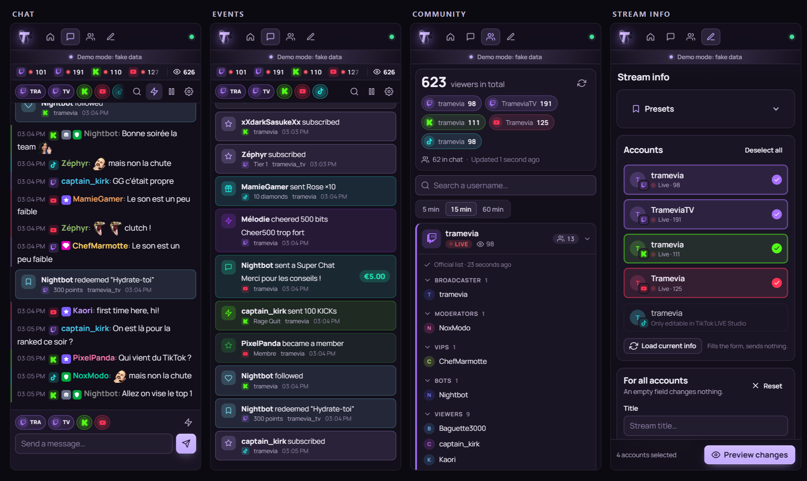

<p align="center"><sub>The four docks, in demo mode. A <b>dock</b> is a small panel you keep in the OBS window, next to your scenes: only you see it.</sub></p>

### 👀 See it live

<p align="center">
  <a href="https://youtu.be/KAMHRxkFxqE">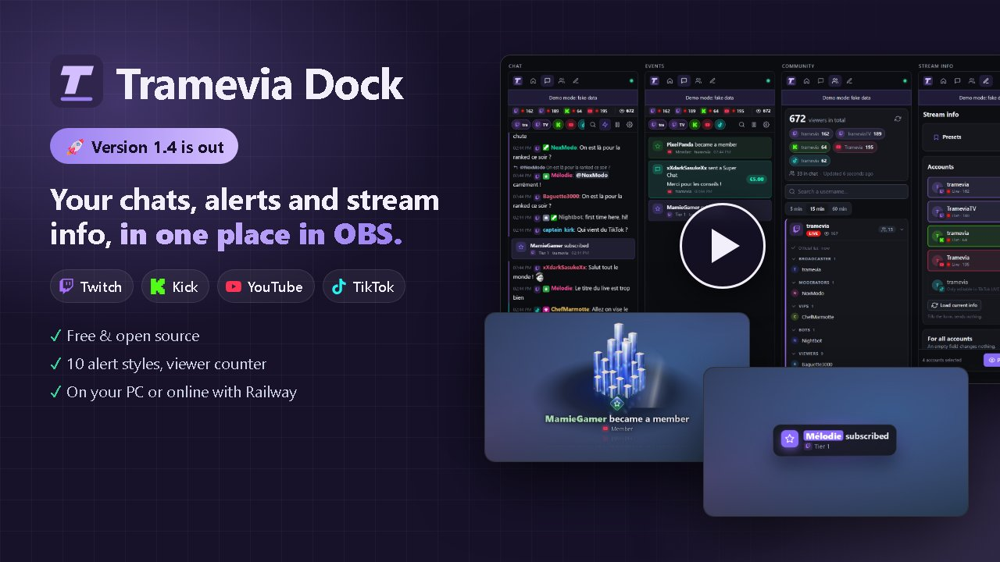</a><br>
  <sub>▶️ <b>Tramevia Dock in 30 seconds</b> (YouTube video)</sub>
</p>

<table>
  <tr>
    <td width="50%" align="center">
      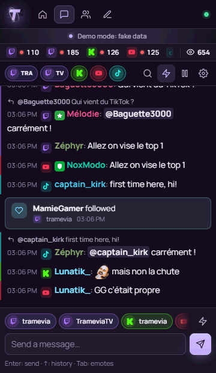
    </td>
    <td width="50%">
      <ul>
        <li>💬 <b>Every chat in one list.</b> Each message shows a small icon, so you always know where it comes from.</li>
        <li>✍️ <b>Answer from OBS.</b> Reply to a message, or send one message to several channels at once.</li>
        <li>🛡️ <b>Moderate on the spot.</b> Delete, timeout, ban and unban without opening five tabs.</li>
        <li>🎉 <b>Never miss a thank-you.</b> Follows, subs, gifts, raids and Super Chats appear right in the chat, and on stream as alerts.</li>
      </ul>
    </td>
  </tr>
</table>

## 🆕 New in 1.4

- 🔔 **On-screen alerts for every platform.** Follows, subs, tips, raids, rewards, TikTok gifts: one alert at a time, with a sound, in **10 animated styles**. → [See the styles](#alerts)
- 👁️ **A live viewer counter.** The total of all your channels in an orb of glowing particles, with every rise (+x) and drop (−x) animated. → [Step 6](#step-6)
- ☁️ **One-click online install.** The **Deploy on Railway** button sets everything up; you only choose a password. → [Railway tutorial](#tutorial-railway)
- 💜 **Support the project (Soon).** A GitHub Sponsors button and supporter codes that unlock new alert styles early, starting with 1.4.5. → [Support](#support)

What changed in each version: [CHANGELOG](CHANGELOG.md).

## 💜 Why Tramevia Dock?

- 💬 **One chat for every platform.** Read, write and moderate Twitch, Kick and YouTube from a single panel, with your TikTok LIVE chat alongside.
- 🔔 **Your alerts and viewer count, no third-party service.** Everything comes from your own connections to the platforms: no Streamlabs or StreamElements account to link.
- 🏷️ **Title, category and tags everywhere in one click.** Fill the form once, check the preview, apply to all your channels. Save your usual setups as presets.
- 🏠 **Your data stays yours.** There is no account to create with us, no Tramevia server in the middle, nothing is collected, and your logins are encrypted on your disk.
- 🎁 **Free and open source.** No subscription, no ads. The interface is in English and French.

## 🧭 How it works

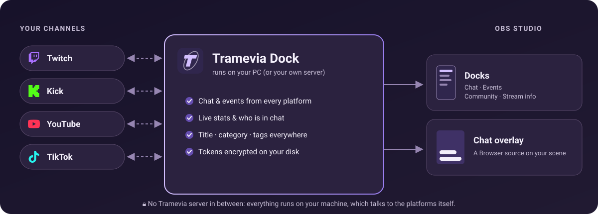

Tramevia Dock is a small program that runs **on your computer** or **on an online server of your own** (Railway, for example). It talks **directly** to Twitch, Kick, YouTube and TikTok, and gives OBS two things:

- **Docks**: panels inside the OBS window (chat, events, community, stream info). Only you see them.
- **Overlays**: see-through layers on your scene that your viewers see on stream (your chat, a featured message, your alerts, your viewer count).

Both are plain web addresses you paste into OBS once.

<a id="choose"></a>

## 🧩 Step 0: choose where Tramevia Dock runs

Two ways, with exactly the same features. Not sure? **Start on your PC**: it's free, and you can move online later.

| | 💻 On your PC | ☁️ Online with Railway |
|---|---|---|
| **Price** | Free | Paid: Railway Hobby plan, from about $5 a month ([current pricing](https://railway.com/pricing)) |
| **Setup** | Node.js + a ZIP to extract, then a double-click | One button and a password, nothing to install |
| **When it runs** | While your PC is on and the Tramevia Dock window is open | 24/7, even with your PC off |
| **Opening the dashboard** | From this PC only, no password | From any device, with your password |
| **Kick chat** | Through kick.com's unofficial socket (works, but unofficial) | Through Kick's official webhooks |
| **Updates** | One click on **Install now** (or automatic if you turn it on) | Automatic, at night |
| **Time** | About 10 minutes, plus 5 minutes per platform | About 5 minutes, plus 5 minutes per platform |
| **Tutorial** | [PC tutorial](#tutorial-pc) ↓ | [Railway tutorial](#tutorial-railway) ↓ |

Then both paths meet: you connect your platforms and add the docks and overlays to OBS ([steps 2 to 7](#step-2)).

> [!TIP]
> **Just curious?** **Demo mode** fills every page with fake channels, chat and alerts, and nothing is sent to any platform. Install on your PC (steps 1 to 3 of the PC tutorial), then double-click **`demo.bat`** instead of `start.bat` (`./start.sh --demo` on macOS and Linux). All the screenshots on this page come from demo mode.

<a id="tutorial-pc"></a>
<a id="install"></a>

## 💻 Step 1 (PC): install Tramevia Dock on your computer

**You need:** Windows 10 or 11, macOS or Linux, [OBS Studio](https://obsproject.com) **31 or newer**, and an internet connection.

### 🪟 Windows

1. **Install Node.js.** It is the free engine that runs Tramevia Dock. Go to [nodejs.org](https://nodejs.org) and download the **LTS** version (24.15 or newer, the `.msi` file). Run the installer and click *Next* through the screens, keeping the default options. You only do this once.
2. **Download Tramevia Dock.** On the [latest release page](https://github.com/Tramevia/Tramevia-Dock/releases/latest), scroll down to **Assets** and click `tramevia-dock-X.Y.Z.zip` (X.Y.Z is the version number). Don't take "Source code": that ZIP can't update itself.

   <p align="center">
     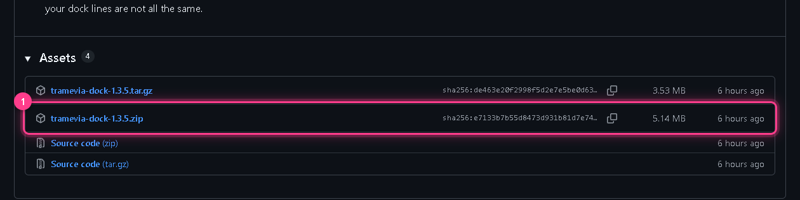
   </p>

3. **Extract the ZIP.** Right-click the downloaded file → *Extract All*, and pick a folder you will keep, for example `Documents\Tramevia Dock`. Don't run anything from inside the ZIP.
4. **Double-click `start.bat`** in that folder. If Windows shows a security warning because the file came from the internet, choose to run it (on the blue "Windows protected your PC" screen: *More info* → *Run anyway*). `start.bat` is a plain text file: you can open it in Notepad to see what it does.
5. **A black window titled "Tramevia Dock" opens**, then your browser opens at <http://localhost:8787>. That's your dashboard! 🎉

If Node.js is missing, the black window tells you and opens nodejs.org; if it's older than 24.15, it asks you to update it. Install it, then double-click `start.bat` again.

> [!IMPORTANT]
> **Keep the black window open while you stream:** it is what runs Tramevia Dock. Closing it stops Tramevia Dock, and your OBS docks and overlays go blank. To stop it, close the window (or press Ctrl+C in it). Next time, a double-click on `start.bat` is all it takes.

### 🍎 macOS

1. Install **Node.js 24.15 or newer** from [nodejs.org](https://nodejs.org) (the LTS `.pkg` installer).
2. Download `tramevia-dock-X.Y.Z.zip` under **Assets** on the [latest release page](https://github.com/Tramevia/Tramevia-Dock/releases/latest), and unzip it into a folder you will keep.
3. Double-click **`start.command`**. If macOS blocks it because it comes from an unidentified developer, allow it once in **System Settings → Privacy & Security → Open Anyway** (on older versions: right-click the file → **Open**).
4. A Terminal window opens, then your browser at <http://localhost:8787>. Keep the Terminal open while you stream.

### 🐧 Linux

Install **Node.js 24.15 or newer** (from [nodejs.org](https://nodejs.org) or your distribution's package manager, if it is recent enough). The easiest way: download the ZIP from the [latest release page](https://github.com/Tramevia/Tramevia-Dock/releases/latest), extract it and run `./start.sh` in that folder. With the ZIP, Tramevia Dock can update itself in one click. Prefer git:

```bash
git clone https://github.com/Tramevia/Tramevia-Dock.git
cd Tramevia-Dock
./start.sh
```

"Permission denied"? Make the scripts executable with `chmod +x start.sh start.command`. On Wayland, OBS may not offer browser docks: open their addresses in a normal browser window instead.

<a id="first-launch"></a>

### ✅ First launch

<p align="center">
  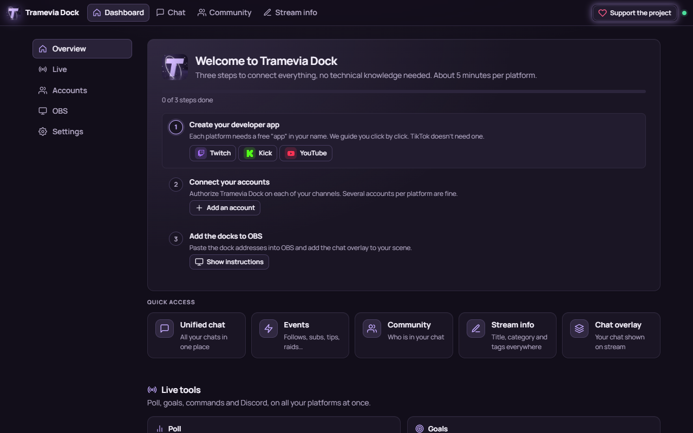
</p>

The dashboard welcomes you with three steps: create your developer app, connect your accounts, add the docks to OBS. That's exactly what [steps 2 and 3](#step-2) below walk you through. On a local install there is **no password**: the dashboard only answers your own computer.

Your accounts, settings and keys live in the `data` folder next to `start.bat`: **back it up, especially `secret.key`**. Uninstalling, changing the port and advanced settings: [Installation guide](docs/en/install.md).

> 💬 **Stuck at this step?** Check [FAQ and troubleshooting](docs/en/faq.md#troubleshooting), or [ask your question in Discussions](https://github.com/Tramevia/Tramevia-Dock/discussions/categories/q-a): we'll help.

Install done: go to [step 2](#step-2).

<a id="tutorial-railway"></a>

## ☁️ Step 1 (Railway): install Tramevia Dock online

[Railway](https://railway.com) runs Tramevia Dock for you on a server, with a public HTTPS address. Your chat, alerts and docks then keep working with your PC off, from any device, and Kick chat comes through the official webhooks.

**You need:** a GitHub account (or an email address) to sign in to Railway, and Railway's **Hobby** plan (paid, [current pricing](https://railway.com/pricing)). The free trial limits outbound connections, which can block Twitch and Kick.

1. **Click this button:**

   [](https://railway.com/deploy/tramevia-dock?utm_medium=integration&utm_source=button&utm_campaign=tramevia-dock)

   The Tramevia Dock template opens on Railway. Click **Deploy Now** (1).

   <p align="center">
     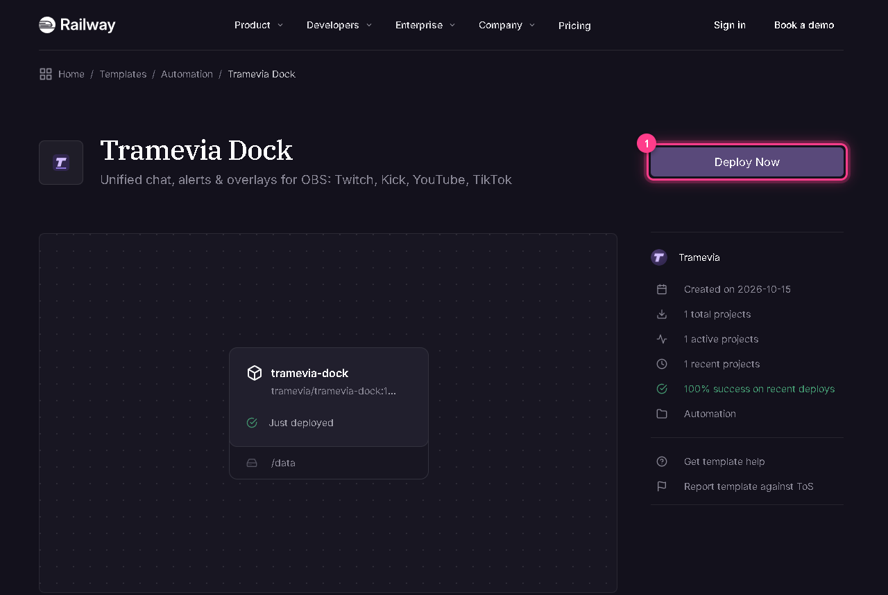
   </p>

2. **Sign in to Railway.** If you don't have an account yet, Railway offers **Continue with GitHub** (1) or email sign-in. If Railway asks, move to the **Hobby** plan in your billing settings.

   <p align="center">
     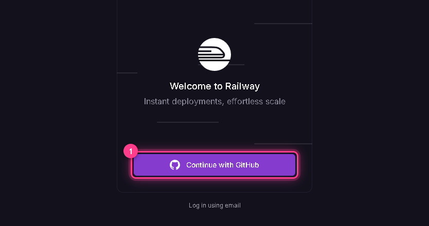
   </p>

3. **Choose your password.** Railway shows the `tramevia-dock` service with **a single variable to fill in: `ADMIN_PASSWORD`**. It's your dashboard password: **12 characters or more**, and not the one from your streaming accounts. Save it in your password manager. Then click **Deploy**.
4. **Wait for the deploy to finish** (a minute or two). The template sets up the image, the `/data` volume for your data, the public address, the healthcheck and nightly automatic updates. The service turns green when it's ready.
5. **Open your address.** Click the `tramevia-dock` service: its public address, something like `https://tramevia-dock-production-xxxx.up.railway.app`, shows under its name (and in **Settings → Networking**). Open it: Tramevia Dock asks for your password.

   <p align="center">
     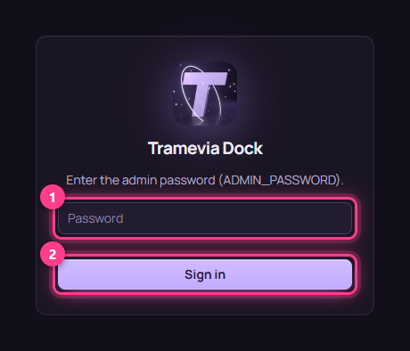
   </p>

6. **Sign in** with your `ADMIN_PASSWORD` (1, 2). The dashboard opens with its three steps, as in the [first launch screenshot](#first-launch). Bookmark the address: it's your dashboard, on any device.

> [!NOTE]
> **What's different online, for the next steps.**
> - The **redirect addresses** the wizard gives you in step 2 start with your Railway address (not `localhost`). That's expected: copy them as they are. If they still show `localhost`, redeploy the service.
> - For **Kick**, also turn on **Enable Webhooks** in your Kick app, with the address `https://your-address.up.railway.app/webhooks/kick`: that's what gives you the official chat (see [Platforms → Kick](docs/en/platforms.md#kick)).
> - An online install is **separate** from an install on your PC: it has its own accounts and settings. The dock and overlay addresses now point to Railway: copy them into OBS again.
> - **Updates** install by themselves at night (2–6 am UTC). To change the window: **Settings → Source → Auto Updates** in Railway.

Your own domain, the manual setup step by step, backups: [Cloud guide](docs/en/cloud.md#railway).

> 💬 **Stuck at this step?** "Host not allowed", a failed service, a refused password: check [FAQ and troubleshooting](docs/en/faq.md#host-not-allowed), or [ask your question in Discussions](https://github.com/Tramevia/Tramevia-Dock/discussions/categories/q-a).

<a id="step-2"></a>
<a id="tutorial"></a>

## 🔌 Step 2: connect your platforms

Twitch, Kick and YouTube ask you to create a free **developer app** in your own name. Don't worry about the name: it is just a permission you create on the platform's website. It lets Tramevia Dock read your chat and update your stream info, **without ever knowing your password** or your stream key. The wizard shows you every click.

1. In the dashboard, open **Accounts** and click **Set up the Twitch app** on the Twitch card.
2. Follow the numbered steps. Buttons open the right Twitch pages for you, and **Copy** buttons give you the app name and the redirect address to paste.
3. Paste your **Client ID** and **Client Secret** in the last step, then click **Save and test**.
4. Click **Connect my Twitch account** and approve on the Twitch page. Done! ✅

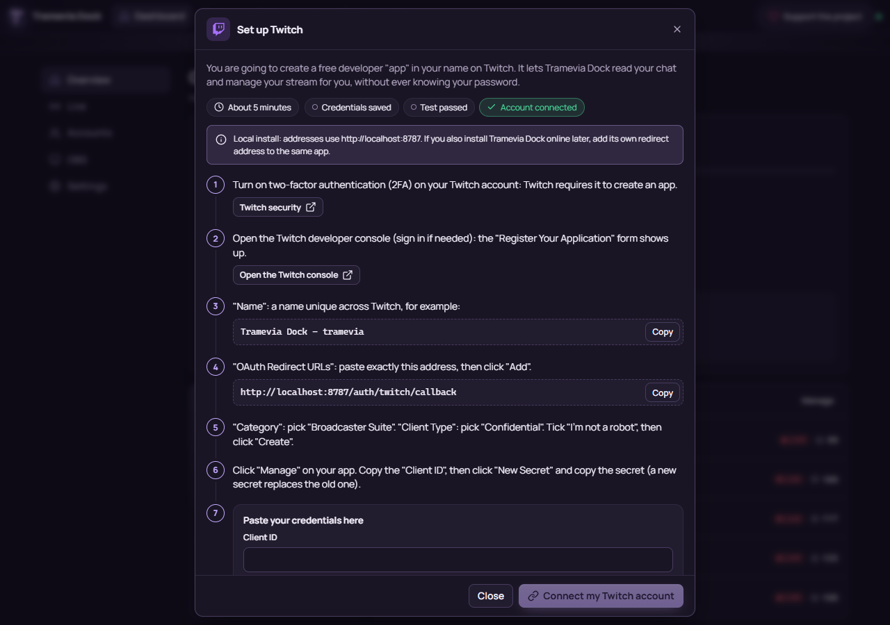

| Platform | What you do | Good to know |
|---|---|---|
| **Twitch** | An app in the Twitch developer console, guided by the wizard | Two-factor authentication (2FA) must be on: the wizard gives you the link |
| **Kick** | An app in Kick's developer settings | 2FA required too. Online, turn on **Enable Webhooks** |
| **YouTube** | A Google Cloud project and an OAuth client | Google warns that the app is "unverified": that's expected, it's your own app |
| **TikTok LIVE** | Nothing to create: type your @username and click **Add** | Read-only (chat, gifts, viewers) |

Count about **5 minutes per platform**. You can connect several accounts per platform (two Twitch channels, for example). The full walkthrough, platform by platform: [Connect your platforms](docs/en/platforms.md).

> 💬 **Stuck?** "Redirect address does not match", an account that needs reconnecting, no Kick chat: [FAQ and troubleshooting](docs/en/faq.md#troubleshooting) goes through the error messages one by one. Otherwise, [ask your question](https://github.com/Tramevia/Tramevia-Dock/discussions/categories/q-a).

<a id="step-3"></a>

## 🧱 Step 3: add the docks to OBS

1. In the dashboard, open **OBS**. The **OBS docks** card gives you one address per dock: Unified chat, Events, Community, Stream info and Dashboard.
2. Click **Copy** (1) next to the dock you want. Start with **Unified chat**.
3. In OBS, open the **Docks** menu → **Custom Browser Docks…**
4. Type a name on the left (for example "Chat"), paste the address on the right in the URL column, and click **Apply**.
5. Do the same for each dock, then drag them where you like in the OBS window. Back in the dashboard, click **I added my docks**.

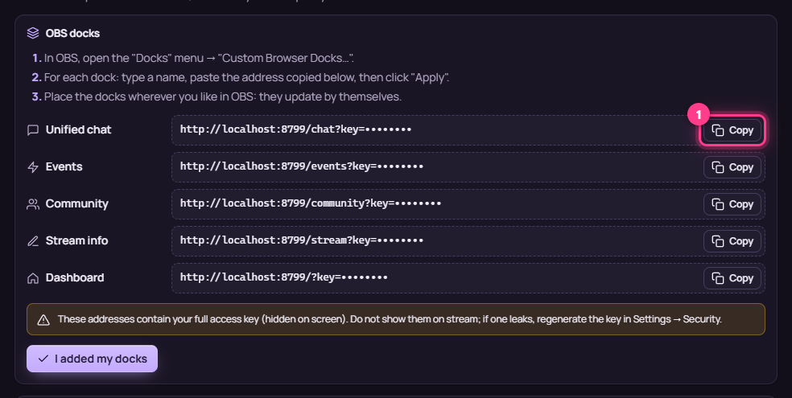

Each dock stays on its own page: no tabs to the other pages inside OBS, and one dock line per page.

> [!IMPORTANT]
> You need **OBS Studio 31 or newer**. The chat dock doesn't work properly in OBS 30's older built-in browser.

> [!WARNING]
> The dock addresses contain your full-access key, which is why it's hidden on screen. **Never show them on stream** and don't share them (not even in a question on GitHub). If one leaks: **Settings → Security → Dock key → Regenerate**, then copy the new addresses into OBS.

<a id="step-4"></a>

## 💬 Step 4: put the chat on your stream

Overlays are set up in the same **OBS** section, right under the docks, in the **Chat overlay** card. There are four, each with its own settings and **its own address**: Chat, Featured message, Alerts and Viewers. One OBS Browser source for each.

1. In the **Chat overlay** card, pick **Chat**, then a **Theme**. The **Live preview** updates as you go (the checkerboard shows transparency), and your settings are saved by themselves.
2. Copy the **Overlay address**.
3. In OBS: **Sources → + → Browser**, give it a name, paste the address in **URL**, set **Width 400** and **Height 600**, then click **OK**.

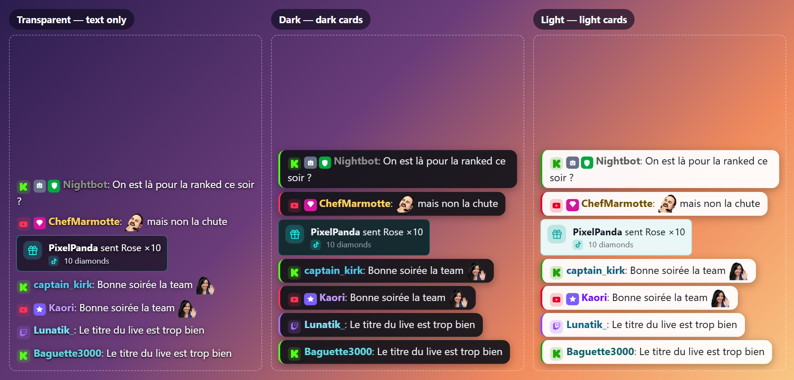

- **Transparent**: text only, right on top of your scene. Turn on *Bubbles* or *Text outline* if your background is busy.
- **Dark**: each message on a dark card with its platform colour. Readable on any background.
- **Light**: each message on a light card with dark text.

You paste the address **once**: when you change a setting later, the overlay in OBS follows live. Paste it again only after you regenerate the overlay key or change the port or `PUBLIC_URL`. Overlays use a separate **read-only** key: their address can't act on your accounts.

> [!TIP]
> **Just one question on screen?** Pick *Featured message*, add its address as a second Browser source, then hover a message in the Chat dock and click its **Show on overlay** star. All options: [OBS guide](docs/en/obs.md).

<a id="alerts"></a>
<a id="step-5"></a>

## 🔔 Step 5: alerts

Every follow, sub, gifted sub, tip (bits, KICKs, Super Chats, TikTok and YouTube gifts), raid, channel point reward, TikTok like and share shows up on screen, **one alert at a time, from all your platforms together**, with a little chime.


1. In the overlay card, pick **Alerts** (1).
2. Copy the address (2). In OBS: **Sources → + → Browser**, paste it, and make the source **the size of your scene** (**Width 1920**, **Height 1080** for a 1080p scene). The alert appears centred at the **top**, **middle** or **bottom** of the source, depending on **Position**.
3. Pick a **Style** (3). The preview shows it right away.
4. Set the **duration** of each alert (6 seconds by default), the **sound volume** (0 = off) and the **text size**. Under **Alerts shown**, turn off the ones you don't want on screen; under **Platforms** and **Accounts**, remove the ones you don't want.
5. Click **Send a test alert** (4): it shows in the preview and in OBS, without waiting for a real follow.

### The 10 styles

![The ten alert styles, each on a scene: Card (a "Mélodie subscribed" card), Big text ("captain_kirk followed" in large letters), Impact (a purple label "Baguette3000 cheered 500 bits"), Eclipse (two walls of light around a raid), Glass (a pink capsule "NoxModo gifted 5 subs"), Switch (a black card with glowing dots), Wave (white particles around a Super Chat), Prism (crystal bars above a new member), Silk (veils of green and blue threads around 100 KICKs) and Neon (a chrome username on a ring). Card and Big text carry a Free label, the eight others a Soon label with the Tramevia logo](docs/assets/screenshots/en/alert-styles.jpg)

| Style | What it looks like | |
|---|---|---|
| **Card** | A glass card floating in 3D | Free |
| **Big text** | Large words right on your scene, no frame | Free |
| **Impact** | A product shot: the alert falls in as three spinning slices that slam together with a splash | Early access |
| **Eclipse** | Light only: two planes cross on a ring, then two tall walls of light frame the text | Early access |
| **Glass** | A frosted-glass capsule becomes a card while a warm light sweeps under it | Early access |
| **Switch** | A switch flips ON with the sound, light bursts out and glowing dots count down the time | Early access |
| **Wave** | A wave of white particles breaks over the alert, the text forms in the dust | Early access |
| **Prism** | Crystal bars on a black glass floor, jumping on every note like an equaliser | Early access |
| **Silk** | Veils of very fine threads weave a sphere around the icon | Early access |
| **Neon** | Your name in big chrome letters on a spinning ring, lit with neon | Early access |

**Card** and **Big text** are free for everyone. The eight others are in **early access (Soon)**: for supporters starting with 1.4.5, then free for everyone. Unlock date:  **Soon** 😎. A locked style shows a lock; if you pick it, the overlay shows Card instead. More in [Support](#support).

> [!TIP]
> **Can't hear the chime on stream?** In the Browser source properties, tick **Control audio via OBS**, and make sure the source isn't muted in the audio mixer. Alerts are shown only as they happen: when OBS reloads the source, old alerts are not replayed.

<a id="step-6"></a>

## 👁️ Step 6: the viewer counter

<p align="center">
  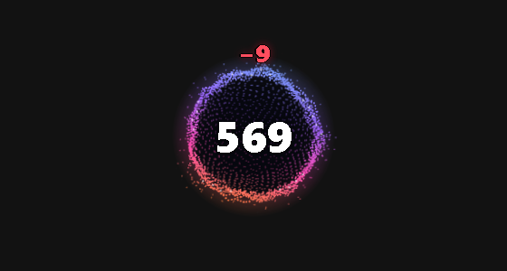
</p>

An orb of glowing particles with **your total live viewers across all your platforms**. When it goes up, a green **+x** animates; when it goes down, a red **−x**.

1. In the overlay card, pick **Viewers** and copy its address.
2. In OBS: **Sources → + → Browser**, paste the address, **Width 400**, **Height 400**. Keep the source at 100% of its size for a crisp number.
3. **Number**: inside the orb (*Centre*), or to its left or right. Under **Platforms** and **Accounts**, remove the ones you don't want counted.
4. Click **Test a change** to see a rise and then a drop.

The total follows the platform polls, about every 30 to 60 seconds.

<a id="step-7"></a>

## 🏷️ Step 7: before each live, set your title everywhere at once

1. Open the **Stream info** dock and check that the channels you want are ticked.
2. Click **Load current info**. It fills the form with what's online now, and sends nothing.
3. Change the **Title**, **Category** (one search for every platform, with box art) and **Tags**.
4. Click **Preview changes**, check the before and after, then click **Apply to … accounts**. You get a result for each channel, and a button to retry only the ones that failed.

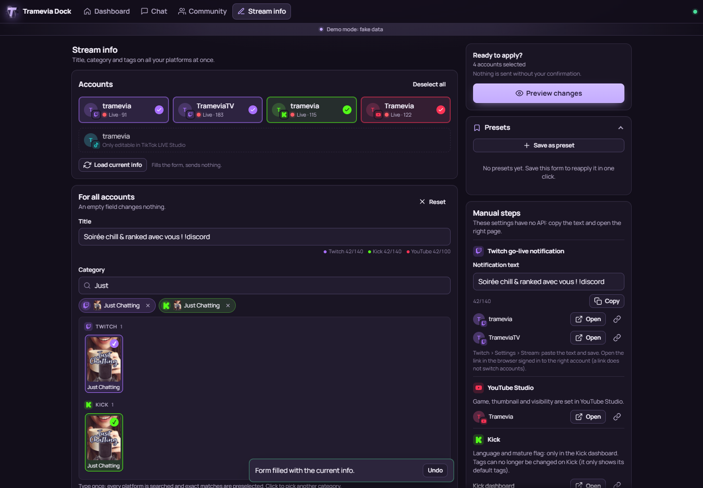

Settings the platforms don't let anyone change remotely (the Twitch go-live notification, the YouTube "Game"…) wait for you under the manual steps, with the text to copy and the right link. On **YouTube**, the title belongs to a specific broadcast: schedule your stream in YouTube Studio first (or start it). The **TikTok LIVE** title can only be changed in the TikTok app or LIVE Studio.

> [!TIP]
> Same setup every Tuesday? Open **Presets** → **Save as preset**, and next time it's one click.

**That's it, you're ready to go live!** 🎬 A question, an idea, want to show your setup? [Join the Discussions](https://github.com/Tramevia/Tramevia-Dock/discussions).

<a id="features"></a>

## ✨ Features

<table>
  <tr>
    <td width="50%" align="center" valign="top">
      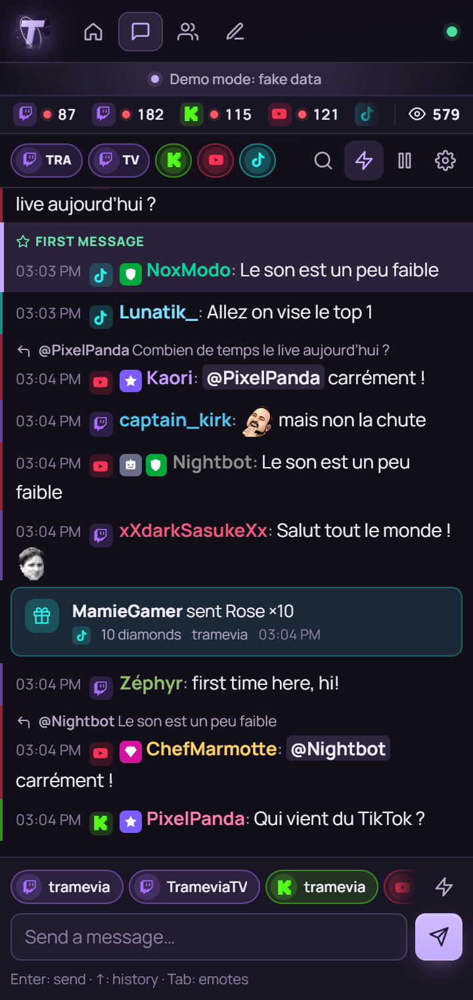<br>
      <b>💬 Unified chat</b><br>
      <sub>Every chat in one list, with emotes, badges, replies and moderation.</sub>
    </td>
    <td width="50%" align="center" valign="top">
      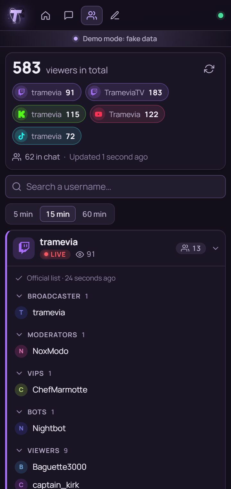<br>
      <b>👥 Community</b><br>
      <sub>Total viewers and who is in your chat, by role.</sub>
    </td>
  </tr>
  <tr>
    <td width="50%" align="center" valign="top">
      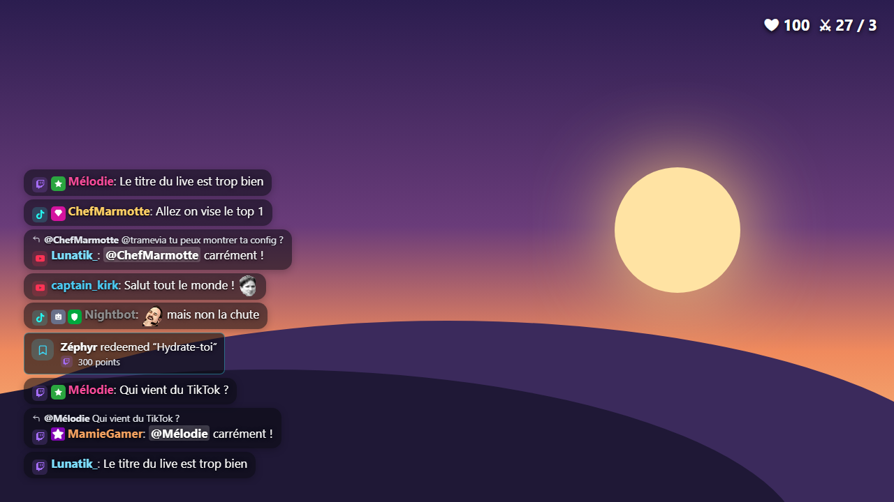<br>
      <b>📺 Chat overlay</b><br>
      <sub>Your chat on stream, set up with a visual builder.</sub>
    </td>
    <td width="50%" align="center" valign="top">
      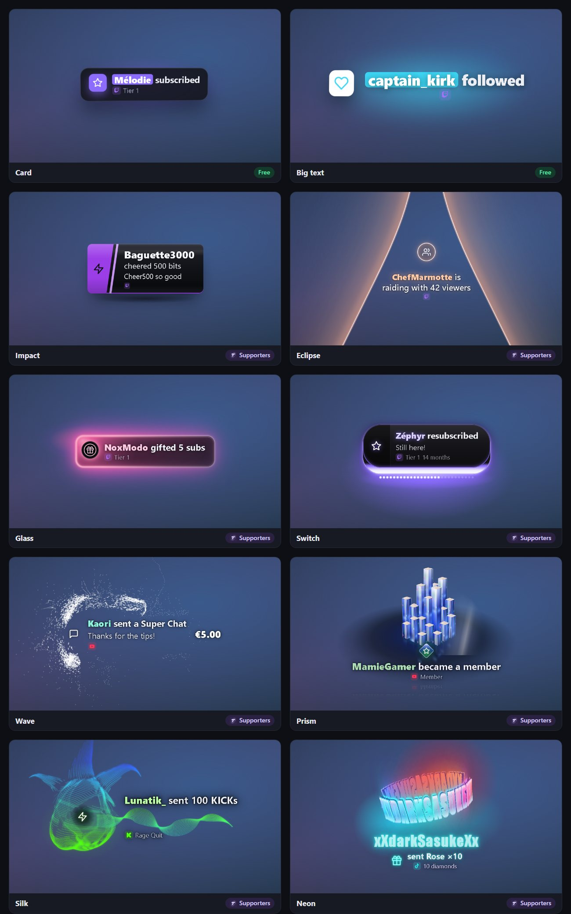<br>
      <b>🔔 Alerts</b><br>
      <sub>Every platform, 10 animated styles.</sub>
    </td>
  </tr>
  <tr>
    <td width="50%" align="center" valign="top">
      <br>
      <b>🏷️ Stream info</b><br>
      <sub>Title, category and tags for all your channels, with presets.</sub>
    </td>
    <td width="50%" align="center" valign="top">
      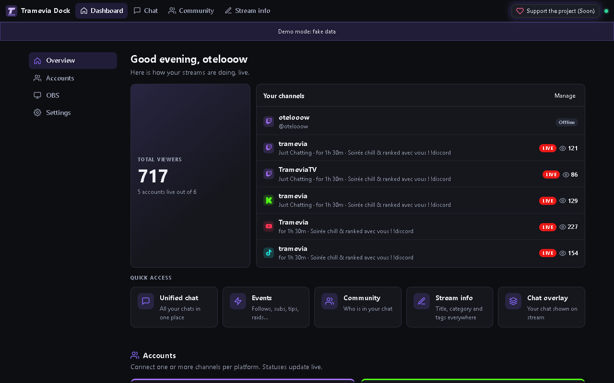<br>
      <b>🏠 Dashboard</b><br>
      <sub>Setup, accounts, OBS addresses and settings in one place.</sub>
    </td>
  </tr>
</table>

<details>
<summary><b>📋 The full feature list</b></summary>

<br>

- **Chat:** one list for all your accounts, with a filter per account, search, pause on hover and a "new messages" pill · native emotes plus 7TV, BetterTTV and FrankerFaceZ · badges, Twitch cheermotes, links, mentions and replies · send to one or several channels at once ("Send to") · message history with ↑ and emote completion with Tab · delete, timeout, ban and unban · user card with their messages from this session (and, on Twitch, the account creation date and "Following since") · highlights for first messages, mentions and your own keywords, with an optional sound when you're mentioned · Twitch stream markers and clips in one click.
- **Events:** follows, subs, gifted subs, cheers, KICKs, Super Chats, Super Stickers, memberships, Jewels, raids, channel point redemptions and TikTok gifts.
- **Community:** combined viewer count and the detail per channel · the real Twitch chatter list, grouped by role (broadcaster, moderators, VIPs, bots) · "active chatters" from the last 5, 15 or 60 minutes on Kick, YouTube and TikTok, which don't share that list.
- **Stream info:** title, category (one search on every platform, with box art) and tags for all your channels · per-account overrides · Twitch language, content classification and branded content · YouTube description and category · presets · preview before sending, a result per channel, and a button to retry only the ones that failed · copy-and-open shortcuts for settings that have no API (Twitch go-live notification, YouTube "Game").
- **Overlays:** four overlays for OBS Browser sources, set up in the dashboard with a live preview · settings saved in the app and applied live, so each address is pasted into OBS only once · **Chat**: three themes (Transparent, Dark, Light), size, fade-out, bubbles, outline, badges, avatars, filters per platform and account · **Featured message**: put one message on screen from the Chat dock · **Alerts**: follows, subs, gifted subs, tips, raids, rewards, TikTok likes and shares from every platform, one at a time, with a chime, 10 styles and a test button · **Viewers**: your total live viewers from every platform, every rise (+x, green) and drop (−x, red) animated.
- **Setup & security:** a wizard for each platform with the exact addresses to paste and a test button · several accounts per platform (two Twitch channels, for example) · tokens encrypted on disk · password required as soon as the app is reachable from the network · dock and overlay keys you can regenerate · runs on Windows, macOS or Linux, or online with Railway (one click) or Docker · one-click or automatic updates · English and French interface.

</details>

## 🌐 Supported platforms

**In short:** everything works on Twitch, almost everything on Kick and YouTube, and TikTok is read-only (you read your chat but can't write in it).

✅ official API · 🟡 official but limited · ⚠️ unofficial · ❌ not possible

| | Twitch | Kick | YouTube | TikTok LIVE |
|---|---|---|---|---|
| Read chat | ✅ | ✅ webhooks (online install)<br>⚠️ Pusher (local install) | ✅ | ⚠️ read-only |
| Send messages | ✅ | ✅ | 🟡 200 characters, uses quota | ❌ |
| Reply to a message | ✅ | ✅ | ❌ | ❌ |
| Moderation (delete, timeout, ban, unban) | ✅ | ✅ timeouts in whole minutes | 🟡 uses quota; unban only for bans made from Tramevia Dock | ❌ |
| Chatter list | ✅ official list with roles | 🟡 active chatters | 🟡 active chatters | ⚠️ active chatters |
| Live status and viewers | ✅ | ✅ | ✅ unless you hide the count | ⚠️ |
| Title | ✅ | ✅ | ✅ needs a live or scheduled broadcast | ❌ TikTok app / LIVE Studio only |
| Category | ✅ search with box art | ✅ search with box art | 🟡 YouTube category list ("Game" only in Studio) | ❌ |
| Tags | ✅ | ❌ no longer editable on Kick | ✅ | ❌ |
| Events and alerts | ✅ follows, subs, gifts, cheers, raids, redemptions | 🟡 follows, subs, gifts, KICKs, redemptions | 🟡 Super Chats, Super Stickers, memberships, Jewels (no follows) | ⚠️ gifts, follows, shares, subs, likes |
| Stream markers and clips | ✅ | ❌ | ❌ | ❌ |

> [!NOTE]
> **Good to know**
> - **TikTok LIVE** has no public API. Tramevia Dock reads it through an unofficial, read-only connection ([tiktok-live-connector](https://github.com/zerodytrash/TikTok-Live-Connector)). It can stop working after a TikTok update.
> - **Kick chat on a local install** goes through Kick's unofficial Pusher socket, because Kick's official webhooks need a public HTTPS address. Official webhooks work when Tramevia Dock runs [online](#tutorial-railway).
> - **YouTube** gives each Google Cloud project 10,000 API units per day. Sending a message or a moderation action costs 50 units. A meter in the app shows what you have used.
> - Some settings have no API on any platform (for example the Twitch go-live notification). The Stream info page gives you a copy button and a link to the right page instead.

All the details, platform by platform: [Connect your platforms](docs/en/platforms.md).

<a id="other-ways-to-install"></a>

## 📦 Other ways to install

<details>
<summary><b>🐳 Docker</b></summary>

<br>

No need for the code: the ready-made image `ghcr.io/tramevia/tramevia-dock` is published with every version.

1. In a new folder, put [`compose.yaml`](compose.yaml) and a file named `.env` with at least a password (12 characters or more):

   ```env
   ADMIN_PASSWORD=choose-a-long-password
   ```

2. Start it:

   ```bash
   docker compose up -d
   ```

3. Open http://localhost:8787 and sign in with your password.

In Docker, the password is **required even locally**. Your data is kept in a Docker volume named `tramevia-data`. To update: `docker compose pull && docker compose up -d` (or turn on the optional nightly auto-update). Full guide: [Cloud and Docker](docs/en/cloud.md).

</details>

<details>
<summary><b>☁️ Railway by hand, your own server or a tunnel</b></summary>

<br>

Prefer to set Railway up yourself instead of using the button? Deploy the Docker image `ghcr.io/tramevia/tramevia-dock` with a full version number, attach a volume at **`/data`**, set **`ADMIN_PASSWORD`**, **`RAILWAY_RUN_UID=0`** and **`PORT=8787`**, generate a domain on port 8787 and turn on **Auto Updates**. The full walkthrough is in the [Cloud guide](docs/en/cloud.md#railway).

Any host that runs a Docker image with a persistent volume at `/data` and HTTPS in front works too. Online, `ADMIN_PASSWORD` (12 characters or more) is mandatory, and the redirect addresses start with your public address: add them to your apps.

Want Kick's official webhooks without a server? A tunnel (Cloudflare Tunnel, ngrok…) in front of your local install is enough: see [Local install with a tunnel](docs/en/cloud.md#local-install-with-a-tunnel-kick-webhooks). Reverse proxies and backups: [Cloud guide](docs/en/cloud.md).

</details>

<a id="updates"></a>

## 🔄 Updates

Tramevia Dock checks once a day whether a new version is out, and tells you on the dashboard. Your accounts, settings and OBS docks stay exactly as they are.

- 💻 **ZIP install:** click **Install now** in the notice. Tramevia Dock restarts by itself in a few seconds, never while you're live, and goes back to the previous version if the new one doesn't start. Prefer hands-free? Turn on automatic install in **Settings → About**.
- ☁️ **Railway:** with the Deploy on Railway button, new versions install by themselves at night. Set up by hand? Turn on Railway's **Auto Updates** once.
- 🐳 **Docker:** run `docker compose pull && docker compose up -d`, or switch on the optional nightly auto-update.

Installed with `git clone`? Run `git pull` and start it again. All the details: [Updating](docs/en/install.md#updating). Each new version is announced in [Discussions → Announcements](https://github.com/Tramevia/Tramevia-Dock/discussions/categories/announcements).

> [!NOTE]
> **Safe by design.** Updates only come from the official releases of this repository. Each download is checked (size and SHA-256 fingerprint) before anything is replaced, and your `data` folder and `.env` file are never touched. Automatic install is **off** until you turn it on. The daily check only tells GitHub your IP address and your version number. Don't want it? Turn it off in **Settings → About**, or set `UPDATE_CHECK=0`. How it works: [SECURITY.md](SECURITY.md#updates--mises-à-jour).

<a id="faq"></a>

## ❓ FAQ

<details>
<summary><b>Is it really free?</b></summary>

<br>

Yes. Tramevia Dock is free and open source. The developer apps on Twitch, Kick and Google are free too, and so is the YouTube API within its daily quota. A local install costs nothing more. If you choose to host it online (Railway, your own server…), you pay that host. Early-access alert styles become free for everyone after their supporter period.

</details>

<details>
<summary><b>Do I need to know how to code?</b></summary>

<br>

No. You double-click a file (or click a button for Railway), and the wizard shows you every click, with **Copy** buttons for everything you need to paste. Creating the free developer apps is the only "technical" part, and it takes about 5 minutes per platform.

</details>

<details>
<summary><b>PC or Railway, which one?</b></summary>

<br>

Start on your PC: it's free and works great as long as your PC is on while you stream. Move to Railway if you want to open your docks from several devices, keep chat and events tracked with your PC off, or read Kick chat through the official webhooks. The full comparison: [Step 0](#choose). The two installs are separate: on Railway, you connect your accounts again.

</details>

<details>
<summary><b>Is it safe? Where are my passwords?</b></summary>

<br>

Tramevia Dock **never sees your platform passwords**: you sign in on each platform's own page. What it keeps (access tokens and app secrets) is encrypted in the `data` folder. By default it only answers your own computer. You can cut its access at any time with **Disconnect**.

Back up the whole `data` folder, including `secret.key`: without that file, the saved logins can't be read and you would have to reconnect everything.

</details>

<details>
<summary><b>Why do some alert styles have a lock?</b></summary>

<br>

**Card** and **Big text** are free for everyone. The eight other styles are in early access: starting with 1.4.5, a supporter code unlocks them early, then they become free for everyone. Unlock date:  **Soon** 😎. Until then, a locked style shows as Card. See [Support](#support).

</details>

<details>
<summary><b>Alerts or the viewer counter don't show in OBS</b></summary>

<br>

Check, in order:

1. The Tramevia Dock window is open (local), or the Railway service is green (online).
2. The address in OBS is the one of the overlay you picked (each overlay has its own: `id=alerts` for alerts, `id=viewers` for the counter).
3. The Alerts source is the size of your scene (for example 1920 × 1080) and isn't hidden behind another source.
4. **Send a test alert** shows it in the dashboard preview: if it does but OBS doesn't, right-click the source → **Refresh**.
5. The alert type, platform and account are ticked in the overlay settings.

Still nothing? See [The overlay shows nothing](docs/en/faq.md#the-overlay-shows-nothing-or-does-not-follow-my-settings), or [ask your question](https://github.com/Tramevia/Tramevia-Dock/discussions/categories/q-a) with your OBS and Tramevia Dock versions.

</details>

<details>
<summary><b>Does it work with Streamlabs or other streaming software?</b></summary>

<br>

Tramevia Dock is made for **OBS Studio** (version 31 or newer): the docks are OBS custom browser docks, and the overlays are OBS Browser sources. The dashboard and every dock are also normal web pages, so you can keep them open in any browser window, next to whatever software you use.

</details>

<details>
<summary><b>Why is TikTok "unofficial"?</b></summary>

<br>

TikTok has no public API for LIVE. Tramevia Dock uses the open-source library [tiktok-live-connector](https://github.com/zerodytrash/TikTok-Live-Connector), which reads the same feed as the TikTok app. So TikTok is **read-only** (chat, gifts, follows, viewers: no sending, no moderation), it needs no password, and it can stop working after a TikTok update until the library and Tramevia Dock are updated.

</details>

<details>
<summary><b>Does Kick chat work on a local install?</b></summary>

<br>

Yes. Kick's official chat webhooks need a public HTTPS address, which a home PC doesn't have. So on a local install, Kick chat is read through the same unofficial chat socket (Pusher) that kick.com uses. Sending messages, moderation and stream info still go through Kick's official API. For the official webhooks, run Tramevia Dock [online](#tutorial-railway) or [behind a tunnel](docs/en/cloud.md#local-install-with-a-tunnel-kick-webhooks).

</details>

<details>
<summary><b>What is the YouTube quota?</b></summary>

<br>

Google gives each Google Cloud project **10,000 units per day**, shared by every YouTube channel using that app, reset at midnight Pacific time. Reading chat costs very little; sending a message or a moderation action costs 50 units, applying stream info about 51. A meter shows your usage on the YouTube account and in the Chat dock. At 95%, Tramevia Dock pauses sending, moderation and stream info changes on YouTube until the reset. It never moderates by itself, so nothing spends quota behind your back.

</details>

<details>
<summary><b>Can I use it on two PCs?</b></summary>

<br>

Yes, in two ways:

- **Online:** host it on Railway (or with Docker), and every device reaches the same install.
- **On your home network:** run it on one PC and open it from the other. You need to open it to your network, set a password and allow the other address: see [Cloud and Docker](docs/en/cloud.md#other-hosts-and-reverse-proxies).

Moving to a new PC? Copy the Tramevia Dock folder **with its `data` folder**: see [I moved to a new PC](docs/en/faq.md#i-moved-to-a-new-pc).

</details>

More answers and fixes for common errors: [FAQ and troubleshooting](docs/en/faq.md). For everything else, [Discussions](https://github.com/Tramevia/Tramevia-Dock/discussions/categories/q-a) are open.

📚 Full guides: [Installation](docs/en/install.md) · [Platforms](docs/en/platforms.md) · [OBS](docs/en/obs.md) · [Cloud](docs/en/cloud.md) · [FAQ](docs/en/faq.md)

<a id="help"></a>

## 💬 Need help? Ask your questions

**Don't hesitate to ask your questions in the project's [GitHub Discussions](https://github.com/Tramevia/Tramevia-Dock/discussions).** There are no silly questions: if you're stuck, others probably are too, and your question helps everyone. English and French are both welcome.

| You want to… | Go here |
|---|---|
| 🙋 Ask a question, get help with the install or OBS | [Discussions → Q&A](https://github.com/Tramevia/Tramevia-Dock/discussions/categories/q-a) |
| 💡 Suggest an idea or a feature | [Discussions → Ideas](https://github.com/Tramevia/Tramevia-Dock/discussions/categories/ideas) |
| 🎬 Show your setup, your scene, your alerts | [Discussions → Show and tell](https://github.com/Tramevia/Tramevia-Dock/discussions/categories/show-and-tell) |
| 📣 Follow new releases | [Discussions → Announcements](https://github.com/Tramevia/Tramevia-Dock/discussions/categories/announcements) |
| 🗳️ Have your say on what comes next | [Discussions → Polls](https://github.com/Tramevia/Tramevia-Dock/discussions/categories/polls) |
| 🐛 Report a specific, reproducible bug | [Issues](https://github.com/Tramevia/Tramevia-Dock/issues) |
| 🔒 Report a security vulnerability | Privately, as explained in [SECURITY.md](SECURITY.md) (no public issue) |

**To get help fast, include in your question:**

- your Tramevia Dock version (**Settings → About**) and your OBS version;
- your install: Windows, macOS or Linux PC, Railway or Docker;
- the platform involved (Twitch, Kick, YouTube, TikTok);
- what you did, what you expected and what happened, with the exact error message or a screenshot.

> [!CAUTION]
> **Never paste** a full dock or overlay address (it contains your key), your `ADMIN_PASSWORD`, a Client Secret, your `.env` file or your `data` folder. On a screenshot, check that the key is hidden (`key=••••••••`).

<a id="security--privacy"></a>

## 🔒 Security & privacy

- **Nothing is collected.** No telemetry, no analytics, no ads, no account with us. Your chat, your stats, your tokens and your settings are never sent to us: there is no Tramevia server to send them to. The code is open, so anyone can check.
- **Self-hosted.** Tramevia Dock runs on your computer or your server. Your access tokens only travel between your install and the platforms themselves.
- **No platform passwords.** You sign in on each platform's own page. Tramevia Dock never sees your password or your stream key.
- **Encrypted.** Your access tokens and app secrets are encrypted on your disk (AES-256-GCM). A copy of the database alone is unreadable: it needs the key in `data/secret.key` (or in `TOKEN_KEY`, if you prefer to keep the key in your password manager).
- **Only your PC, by default.** Out of the box, Tramevia Dock only answers your own computer. As soon as it can be reached from the network (online, home network, tunnel), a password is required, and login attempts are limited.
- **Protected from other websites.** A web page you visit can't read or control your Tramevia Dock: requests coming from other sites are refused.
- **Keys you can change.** Dock addresses contain a full-access key, overlay addresses a separate read-only key. Treat them like passwords, and get new ones in **Settings → Security** if one leaks.
- **Supporter codes checked offline.** A supporter code is checked with a signature, right inside Tramevia Dock: nothing is sent anywhere to validate it.
- **Disconnect** removes an account and its tokens from the database and asks the platform to revoke them.
- **Verified updates.** Only official releases from this repository, checked with SHA-256 before they replace anything (see [Updates](#updates)).

> [!TIP]
> **PC lost or stolen, or `data` folder shared by mistake?** Remove Tramevia Dock's access in each platform's account settings (for example [Twitch → Connections](https://www.twitch.tv/settings/connections) and your [Google account permissions](https://security.google.com/settings/security/permissions)), and create a new Client Secret for your developer apps. The copied tokens then stop working.

<details>
<summary><b>Technical details: encryption, what is stored, which services are contacted</b></summary>

<br>

**Sign-in and encryption.** You connect each platform with OAuth. OAuth tokens and app secrets are encrypted (AES-256-GCM) with a key from `TOKEN_KEY` or the `data/secret.key` file.

**Network.** Without `ADMIN_PASSWORD`, the server only listens on `127.0.0.1` and only answers this computer. As soon as it is reachable from the network (cloud, LAN, tunnel), `ADMIN_PASSWORD` is required (12 characters or more). Login attempts are rate-limited.

**Stored** in `data/tramevia-dock.db` on your machine: your platform app credentials (encrypted), connected accounts (name, avatar, granted permissions, encrypted tokens), presets, interface and overlay settings, the dock and overlay keys, the ids of chatters already seen (for the "first message" highlight), the ids of YouTube bans made from the app (so you can unban), the YouTube quota counter and your Kick chat room id. Chat messages and events are kept in memory only (the last 400) and are not written to disk.

**Other services contacted:** the platforms themselves, Kick's Pusher chat socket (for Kick chat in unofficial mode), the 7TV, BetterTTV and FrankerFaceZ emote APIs (with your channel id), for TikTok the Euler Stream signing server used by tiktok-live-connector, and GitHub once a day to check for a new version (turn it off in **Settings → About**, or with `UPDATE_CHECK=0`). Apart from the platforms you connect, none of these services receives your tokens or passwords.

</details>

Tramevia Dock uses YouTube API Services. By connecting a YouTube account you agree to the [YouTube Terms of Service](https://www.youtube.com/t/terms), and Google's use of data is covered by the [Google Privacy Policy](https://policies.google.com/privacy). You can revoke Tramevia Dock's access to your Google account at any time from your [Google account permissions](https://security.google.com/settings/security/permissions).

Found a vulnerability? Please read [SECURITY.md](SECURITY.md) instead of opening a public issue.

<a id="support"></a>

## 💜 Support Tramevia Dock (Soon)

> [!TIP]
> **Tramevia Dock is free and will stay free: no ads, no subscription.**
> It's made by a streamer, for streamers. If it saves you time before each live, sponsoring it helps keep the project going and growing.

**How it will work (starting with 1.4.5):**

1. You sponsor the project on [GitHub Sponsors](https://github.com/sponsors/Tramevia).
2. You receive a personal **supporter code**.
3. You paste it in **Settings → About**: the early-access alert styles unlock right away, with no server involved (the code is checked offline).

Each early-access style then becomes **free for everyone**. Unlock date:  **Soon** 😎. **Card** and **Big text** stay free for everyone, starting now.

<p align="center">
  <a href="https://github.com/sponsors/Tramevia"></a>
</p>

<p align="center"><sub>No budget? Starring ⭐ this repository, telling another streamer about it, <a href="https://github.com/Tramevia/Tramevia-Dock/discussions/categories/show-and-tell">showing your setup</a> or reporting a bug helps a lot too.</sub></p>

## 🤝 Contributing, license and credits

**Contributing.** Ideas, bug reports and pull requests are welcome! Got an idea? Start it in [Discussions → Ideas](https://github.com/Tramevia/Tramevia-Dock/discussions/categories/ideas). Before proposing a code change, read [CONTRIBUTING.md](CONTRIBUTING.md). To tinker without any account, `npm run demo` starts demo mode and `npm test` runs the tests.

[Discussions](https://github.com/Tramevia/Tramevia-Dock/discussions) · [Report a problem](https://github.com/Tramevia/Tramevia-Dock/issues) · [Changelog](CHANGELOG.md)

**License.** [AGPL-3.0](LICENSE). You are free to use, study and modify Tramevia Dock, on as many channels as you like. If you distribute a modified version, or host one for other people over a network, you must share its source code under the same license, and keep the copyright notice.

**Copyright © 2026 Tramevia.** The Tramevia name and logo are not covered by the license (AGPL-3.0 section 7e): a modified version you distribute or host must use its own name and logo.

**Credits.**

- [tiktok-live-connector](https://github.com/zerodytrash/TikTok-Live-Connector) for TikTok LIVE (AGPL-3.0)
- [ws](https://github.com/websockets/ws) for WebSockets
- [Simple Icons](https://simpleicons.org) for the platform glyphs (CC0)
- [7TV](https://7tv.app), [BetterTTV](https://betterttv.com) and [FrankerFaceZ](https://www.frankerfacez.com) for third-party emotes

---

<sub>Tramevia Dock is an independent project. It is not affiliated with, endorsed or sponsored by Twitch, Kick, YouTube, Google or TikTok. All trademarks and logos belong to their owners and are only used to identify the platforms.</sub>

<p align="center"><a href="#top">↑ Back to top</a></p>
