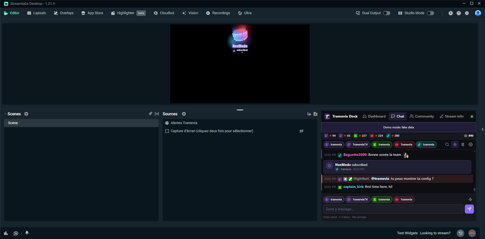

<a href="../fr/streamlabs.md">🇫🇷 Français</a>

# Use Tramevia Dock with Streamlabs Desktop

[← Back to the README](../../README.md) · [Installation](install.md) · [OBS](obs.md) · [Platforms](platforms.md) · [FAQ](faq.md)

Tramevia Dock also works with **Streamlabs Desktop** (tested with version 1.21.9):

- the **dock** goes inside the Streamlabs window through the **Website** element of the layout editor;
- the **overlays** (chat, alerts, viewers, featured message) are added as in OBS, as a **Browser Source**.

Everything you need is in the dashboard's **OBS** section: the addresses are the same as for OBS.

## The dock

Streamlabs has no "custom browser docks" like OBS. Instead, its layout editor has a **Website** element that shows a web page in one slot of the window.

> [!NOTE]
> The layout editor needs you to be **logged in to a Streamlabs account**. When logged out, the "Layouts" menu is not shown.

1. In the dashboard's **OBS** section, click "Copy" next to the **Chat** dock address (or the one you want).
2. In Streamlabs, open **Layouts** (top bar).
3. Pick a layout, then drag the **Website** element into a slot that is big enough. The dock works from 300 pixels wide; for the chat, aim for at least 350 × 400.
4. Paste the address in the element's URL field, then click **Save Changes**.
5. Go back to the **Editor**: the dock shows in its slot.

There is only one Website element per layout tab. That is fine: in Streamlabs the dock keeps its tab bar (**Dashboard**, **Chat**, **Community**, **Stream info**), so one slot gives you every page. To show two at once, add a tab with **Add Tab** and another Website element.

The dock signs in with the key inside the address: no password to type in Streamlabs. The same rules as for OBS apply: never show this address on stream, and regenerate the key if it leaks (see [The key in the dock addresses](obs.md#the-key-in-the-dock-addresses)).

## The overlays

1. In the dashboard's **OBS** section, pick the overlay (Chat, Featured message, Alerts or Viewers) and copy its address.
2. In Streamlabs, next to **Sources**, click **+**, pick **Browser Source** (under "Capture Sources"), then **Add Source**.
3. Paste the address in the **URL** field and set **Width** and **Height**:

| Overlay | Width × height |
|---|---|
| Alerts | 1920 × 1080 (your scene size) |
| Viewers | 400 × 400 |
| Chat, Featured message | 400 × 600 |

Settings live in the dashboard and apply live, as in OBS (see the [OBS guide](obs.md#chat-overlay)). All ten alert styles render correctly in Streamlabs.

> [!TIP]
> For the alert chime to be heard on your stream, tick **Control audio via Streamlabs Desktop** in the source properties (it is off by default).

## Tips

- A source that is not visible is paused ("Shutdown source when not visible", on by default). Alerts that arrive meanwhile are not replayed.
- If an overlay does not update after a Tramevia Dock update, open the source properties and click **Refresh cache of current page**.
- If the dock slot is too small, pick another layout or make the Streamlabs window bigger: the dock adapts to the space it gets.
