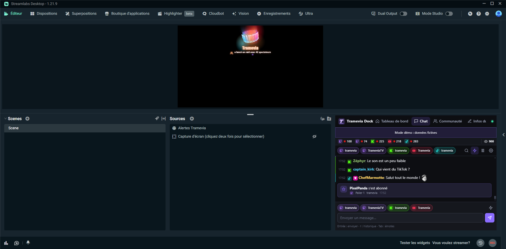

<a href="../en/streamlabs.md">🇬🇧 English</a>

# Utiliser Tramevia Dock avec Streamlabs Desktop

[← Retour au README](../../README.fr.md) · [Installation](install.md) · [OBS](obs.md) · [Plateformes](platforms.md) · [FAQ](faq.md)

Tramevia Dock marche aussi avec **Streamlabs Desktop** (testé avec la version 1.21.9) :

- le **dock** se place dans la fenêtre de Streamlabs grâce à l’élément **Site Web** de l’éditeur de dispositions ;
- les **overlays** (chat, alertes, spectateurs, message mis en avant) s’ajoutent comme dans OBS, en **Source du navigateur**.

Tout se prépare dans le tableau de bord, section **OBS** (<http://localhost:8787>, menu de gauche) : les adresses sont les mêmes que pour OBS.

## Le dock

Streamlabs n’a pas de « docks de navigateur personnalisés » comme OBS. À la place, son éditeur de dispositions propose un élément **Site Web** qui affiche une page dans un emplacement de la fenêtre.

> [!NOTE]
> L’éditeur de dispositions demande d’être **connecté à un compte Streamlabs**. Sans connexion, le menu « Dispositions » n’apparaît pas.

1. Dans le tableau de bord, section **OBS**, clique sur « Copier » à côté de l’adresse du dock **Chat** (ou de celui que tu veux).
2. Dans Streamlabs, ouvre **Dispositions** (barre du haut).
3. Choisis une disposition, puis fais glisser l’élément **Site Web** dans un emplacement assez grand. Le dock fonctionne dès 300 pixels de large ; pour le chat, vise au moins 350 × 400.
4. Colle l’adresse dans le champ URL de l’élément, puis clique sur **Enregistrer les modifications**.
5. Retourne dans l’**Éditeur** : le dock s’affiche dans son emplacement.

Il n’y a qu’un élément Site Web par onglet de disposition. Ce n’est pas gênant : dans Streamlabs, le dock garde sa barre d’onglets (**Tableau de bord**, **Chat**, **Communauté**, **Infos du live**), donc un seul emplacement donne accès à toutes les pages. Pour en afficher deux en même temps, ajoute un onglet avec **Ajouter un onglet** et un autre élément Site Web.

La connexion se fait avec la clé contenue dans l’adresse : pas de mot de passe à saisir dans Streamlabs. Les mêmes règles que pour OBS s’appliquent : ne montre jamais cette adresse en live, et régénère la clé en cas de fuite (voir [La clé dans l’adresse des docks](obs.md#la-clé-dans-ladresse-des-docks)).

## Les overlays

1. Dans le tableau de bord, section **OBS**, choisis l’overlay (Chat, Message mis en avant, Alertes ou Spectateurs) et copie son adresse.
2. Dans Streamlabs, à côté de **Sources**, clique sur **+**, choisis **Source du navigateur** (dans « Sources de capture »), puis **Ajouter une source**.
3. Colle l’adresse dans le champ **URL** et règle **Largeur** et **Hauteur** :

| Overlay | Largeur × hauteur |
|---|---|
| Alertes | 1920 × 1080 (la taille de ta scène) |
| Spectateurs | 400 × 400 |
| Chat, Message mis en avant | 400 × 600 |

Les réglages se font dans le tableau de bord et s’appliquent en direct, comme dans OBS (voir le [guide OBS](obs.md#overlay-de-chat)). Les dix styles d’alertes s’affichent correctement dans Streamlabs.

> [!TIP]
> Pour que le carillon des alertes s’entende dans ton stream, coche **Contrôler l’audio via Streamlabs Desktop** dans les propriétés de la source (c’est décoché par défaut).

## Astuces

- Une source qui n’est pas visible est mise en pause (option « Désactiver la source quand elle n’est pas visible », cochée par défaut). Les alertes arrivées pendant ce temps ne repassent pas.
- Si un overlay ne se met pas à jour après une mise à jour de Tramevia Dock, ouvre les propriétés de la source et clique sur **Rafraîchir le cache de cette page**.
- Si l’emplacement du dock est trop petit, choisis une autre disposition ou agrandis la fenêtre de Streamlabs : le dock s’adapte à la place disponible.
